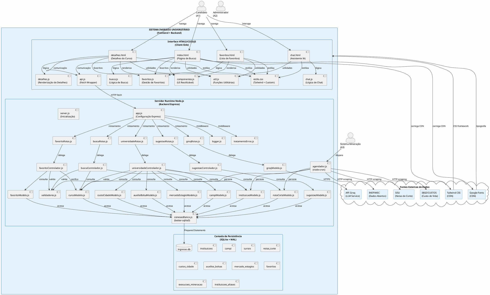
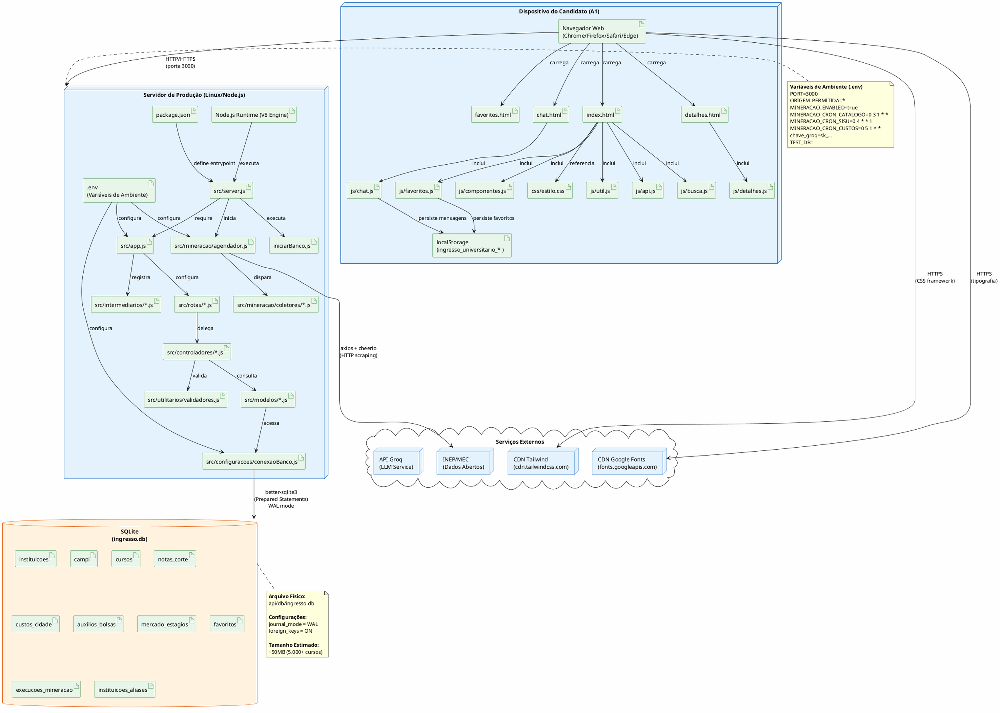
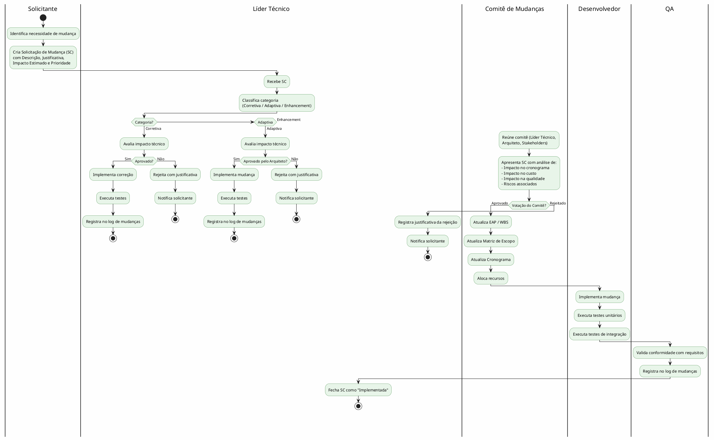

# Escopo do Projeto — Sistema Ingresso Universitário

**Versão do Documento:** 1.0  
**Data:** 08 de setembro de 2026  
**Padrões de Referência:** PMBOK 7ª Edição · OMG UML 2.5.1 · ISO/IEC/IEEE 29148:2018  
**Classificação:** Documento de Gestão de Escopo do Projeto (Project Scope Statement)

---

## Sumário

1. [Justificativa de Engenharia e Objetivos SMART](#1-justificativa-de-engenharia-e-objetivos-smart)
2. [Delimitação das Fronteiras do Sistema (System Boundary)](#2-delimitação-das-fronteiras-do-sistema-system-boundary)
3. [Escopo do Produto por Módulos Arquiteturais](#3-escopo-do-produto-por-módulos-arquiteturais)
4. [Diagrama de Componentes UML 2.5.1](#4-diagrama-de-componentes-uml-251)
5. [Diagrama de Implantação (Deployment Diagram)](#5-diagrama-de-implantação-deployment-diagram)
6. [Estrutura Analítica do Projeto (EAP / WBS)](#6-estrutura-analítica-do-projeto-eap--wbs)
7. [Limites Explícitos do Projeto](#7-limites-explícitos-do-projeto)
8. [Matrizes de Controle](#8-matrizes-de-controle)
9. [Governança e Processo de Controle de Mudanças](#9-governança-e-processo-de-controle-de-mudanças)

---

## 1. Justificativa de Engenharia e Objetivos SMART

### 1.1 Contexto e Problema

O processo de ingresso no ensino superior brasileiro envolve múltiplas variáveis que o candidato precisa considerar: notas de corte de processos seletivos (SiSU, ProUni), custos de moradia/alimentação/transporte na cidade da universidade, bolsas e auxílios disponíveis, e perspectivas de mercado de trabalho. Atualmente, essas informações estão dispersas em diferentes portais governamentais (MEC, INEP, SiSU), sites de instituições individuais e fontes de dados abertos, dificultando a tomada de decisão informada, especialmente para estudantes de baixa renda e de regiões periféricas.

### 1.2 Justificativa da Stack Tecnológica

A escolha pela stack **Node.js + Express + SQLite + HTML5/CSS3/JS Vanilla** justifica-se por:

| Critério | Justificativa |
|----------|---------------|
| **Custo Zero** | Todas as dependências são open-source e gratuitas. SQLite não requer servidor dedicado. CDN Tailwind elimina build tools. |
| **Complexidade Reduzida** | Node.js com Express permite prototipagem rápida. SQLite elimina a necessidade de configurar um SGBD separado. JS Vanilla elimina dependência de frameworks (React, Angular, Vue). |
| **Performance** | better-sqlite3 é driver nativo síncrono com WAL mode. Express é minimalista com overhead mínimo. Tailwind via CDN elimima etapa de build. |
| **Portabilidade** | Node.js é cross-platform. better-sqlite3 fornece binários pré-compilados. Não há dependências de sistema operacional. |
| **Manutenibilidade** | Padrão MVC com separação clara. JavaScript em todo o stack (frontend + backend). Sem transpilação (ES6+ nativo). |
| **Escalabilidade** | Arquitetura stateless permite horizontal scaling. SQLite com WAL suporta leitura concorrente. Express é não bloqueante por natureza. |

### 1.3 Objetivos SMART

| Objetivo | SMART | Descrição |
|----------|-------|-----------|
| **O1** | **E**specífico | Disponibilizar uma plataforma web unificada que consolide dados de notas de corte, custos de vida, bolsas e mercado de trabalho para cursos de graduação em instituições públicas brasileiras. |
| | **M**ensurável | O sistema deve catalogar pelo menos 5.000 cursos de 1.000+ instituições públicas, com notas de corte históricas (SiSU) de pelo menos 3 anos. |
| | **A**lcançável | Utiliza dados abertos do MEC/INEP e web scraping automatizado, com stack de baixa complexidade operacional. |
| | **R**elevante | Auxilia candidatos ao ensino superior na tomada de decisão informada, reduzindo desigualdade de acesso à informação. |
| | **T**emporal | MVP funcional em 8 semanas; versão completa com mineração automatizada em 12 semanas. |
| **O2** | **E**specífico | Implementar sistema de favoritos persistente (localStorage + API) para permitir comparação ao longo do tempo. |
| | **M**ensurável | 100% dos cursos visualizados podem ser favoritados. Favoritos persistem entre sessões. |
| | **A**lcançável | Utiliza localStorage para persistência local e API REST para persistência server-side. |
| | **R**elevante | Permite ao candidato manter lista personalizada de opções de interesse. |
| | **T**emporal | Implementado juntamente com MVP (8 semanas). |
| **O3** | **E**specífico | Implementar assistente virtual via IA generativa para responder dúvidas sobre cursos e universidades. |
| | **M**ensurável | O chat deve responder a perguntas sobre o domínio em menos de 5 segundos (p95). |
| | **A**lcançável | Utiliza API Groq com modelos open-source (Qwen, Allam) sem custo para volumes moderados. |
| | **R**elevante | Oferece interação conversacional para candidatos que não conseguem formular buscas complexas. |
| | **T**emporal | Implementado na semana 10 (pós-MVP). |

---

## 2. Delimitação das Fronteiras do Sistema (System Boundary)

### 2.1 Diagrama de Contexto em PlantUML



### 2.2 Descrição das Fronteiras

| Fronteira | Componentes Internos | Componentes Externos | Protocolo |
|-----------|---------------------|---------------------|-----------|
| **Interface HTML5/JS ↔ Backend Express** | api.js (fetch), todas as rotas /api/* | app.js (express static + API routes) | HTTP/HTTPS (fetch API) |
| **Backend Express ↔ Banco de Dados** | Modelos (*Modelo.js), conexaoBanco.js | SQLite (ingresso.db) | better-sqlite3 (nativo C++) |
| **Backend Express ↔ Serviço Groq** | groqModelo.js | api.groq.com | HTTPS REST (fetch) |
| **Backend Express ↔ Fontes de Dados** | coletores/*.js (mineracao) | INEP, MEC, IBGE | HTTP/HTTPS (axios + cheerio) |
| **Frontend ↔ CDNs Externas** | HTML (link/script tags) | cdn.tailwindcss.com, fonts.googleapis.com | HTTPS |
| **Agendador ↔ Backend** | agendador.js (node-cron) | todas as rotinas de mineração | Interno (function call) |

---

## 3. Escopo do Produto por Módulos Arquiteturais

### 3.1 Módulo 1: Interface do Cliente (Frontend)

#### 3.1.1 Entregáveis Físicos

| Arquivo | Tipo | Descrição |
|---------|------|-----------|
| `frontend/index.html` | HTML5 | Página principal com formulário de busca, seção Hero, área de resultados com paginação incremental |
| `frontend/chat.html` | HTML5 | Página de chat com assistente IA, painel flutuante, persistência de mensagens no localStorage |
| `frontend/paginas/detalhes.html` | HTML5 | Página de detalhes do curso com abas navegáveis (notas, custos, bolsas, mercado, outros cursos) |
| `frontend/paginas/favoritos.html` | HTML5 | Página de listagem de cursos favoritos com sincronização local/API |
| `frontend/css/estilo.css` | CSS3 | Estilos customizados (skeleton loading, animações, scrollbar, badges) |
| `frontend/js/util.js` | JS (ES6+) | Funções utilitárias: escapeHTML, gerarUUID, debounce, toast, formatarMoeda, badge, skeleton, montarNavbar |
| `frontend/js/api.js` | JS (ES6+) | Cliente HTTP genérico (fetch wrapper) com tratamento de erros |
| `frontend/js/busca.js` | JS (ES6+) | Lógica da página de busca: filtros, debounce, paginação, autocomplete, renderização |
| `frontend/js/favoritos.js` | JS (ES6+) | Sistema de favoritos: localStorage + sincronização com API, toggle, persistência |
| `frontend/js/detalhes.js` | JS (ES6+) | Renderização de detalhes do curso: abas, dados dinâmicos, skeleton |
| `frontend/js/componentes.js` | JS (ES6+) | Componentes UI reutilizáveis: cardResultado, botaoFavorito, tabelaNotas, listaAuxilios |
| `frontend/js/chat.js` | JS (ES6+) | Lógica do chat: envio/recebimento de mensagens, indicador de digitação |
| `frontend/js/dadosDemo.js` | JS (ES6+) | Dados de demonstração (fallback quando API indisponível) |

### 3.2 Módulo 2: Servidor Backend (API REST)

#### 3.2.1 Entregáveis Físicos

| Arquivo | Tipo | Descrição |
|---------|------|-----------|
| `api/src/server.js` | JS | Ponto de entrada: inicialização do banco, verificação de dados, agendador, listen na porta |
| `api/src/app.js` | JS | Configuração Express: middlewares (helmet, cors, json, logger), rotas, fallback SPA, error handler |
| `api/src/rotas/buscaRotas.js` | JS | Rota GET /api/busca → buscaControlador.buscar |
| `api/src/rotas/universidadeRotas.js` | JS | Rotas de instituições, cursos, notas, custos, auxílios, mercado, campi |
| `api/src/rotas/favoritoRotas.js` | JS | Rotas POST/GET/DELETE de favoritos |
| `api/src/rotas/sugestaoRotas.js` | JS | Rota GET /api/sugestoes → sugestaoControlador.listar |
| `api/src/rotas/groqRotas.js` | JS | Rota POST /api/groq-chat → groqModelo.gerarResposta |
| `api/src/controladores/buscaControlador.js` | JS | Lógica de busca unificada com validação e paginação |
| `api/src/controladores/universidadeControlador.js` | JS | Lógica de listagem/detalhamento de instituições, cursos e dados associados |
| `api/src/controladores/favoritoControlador.js` | JS | Lógica de CRUD de favoritos com verificação de propriedade |
| `api/src/controladores/sugestaoControlador.js` | JS | Lógica de sugestões autocomplete |
| `api/src/modelos/instituicaoModelo.js` | JS | Data access layer para instituições (busca, inserção, atualização, contagem) |
| `api/src/modelos/cursoModelo.js` | JS | Data access layer para cursos (busca, detalhe, inserção, verificação) |
| `api/src/modelos/favoritoModelo.js` | JS | Data access layer para favoritos (inserção segura, listagem, remoção) |
| `api/src/modelos/notaCorteModelo.js` | JS | Data access layer para notas de corte |
| `api/src/modelos/custoCidadeModelo.js` | JS | Data access layer para custos de cidade |
| `api/src/modelos/auxilioBolsaModelo.js` | JS | Data access layer para auxílios e bolsas |
| `api/src/modelos/mercadoEstagioModelo.js` | JS | Data access layer para mercado e estágios |
| `api/src/modelos/sugestaoModelo.js` | JS | Data access layer para sugestões (busca por termo) |
| `api/src/modelos/campiModelo.js` | JS | Data access layer para campi |
| `api/src/modelos/groqModelo.js` | JS | Integração com API Groq (fallback de modelos, system prompt) |
| `api/src/configuracoes/conexaoBanco.js` | JS | Configuração da conexão SQLite (WAL, foreign keys) |
| `api/src/utilitarios/validadores.js` | JS | Funções de sanitização e validação (trim, escape, validarId) |
| `api/src/intermediarios/logger.js` | JS | Middleware de logging (método, URL, status, duração) |
| `api/src/intermediarios/tratamentoErros.js` | JS | Middleware global de tratamento de erros |
| `api/iniciarBanco.js` | JS | DDL das tabelas, dados seed, execução de migrações |
| `api/package.json` | JSON | Manifesto de dependências e scripts npm |

### 3.3 Módulo 3: Mineração de Dados (Web Scraping)

#### 3.3.1 Entregáveis Físicos

| Arquivo | Tipo | Descrição |
|---------|------|-----------|
| `api/src/mineracao/agendador.js` | JS | Agendador de tarefas com node-cron (catálogo, SiSU, custos) |
| `api/src/mineracao/coletores/coletorCatalogo.js` | JS | Coletor de catálogo INEP de instituições |
| `api/src/mineracao/coletores/coletorSisu.js` | JS | Coletor de notas de corte SiSU |
| `api/src/mineracao/coletores/coletorCustoVida.js` | JS | Coletor de custos de vida por cidade |
| `api/src/mineracao/coletores/coletorAuxilios.js` | JS | Coletor de bolsas e auxílios |
| `api/src/mineracao/coletores/coletorMercado.js` | JS | Coletor de dados de mercado e estágios |
| `api/src/mineracao/coletores/coletorCampi.js` | JS | Coletor de campi por instituição |
| `api/src/mineracao/coletores/coletorCursos.js` | JS | Coletor de cursos por instituição |
| `api/src/mineracao/coletores/coletorInstituicoes.js` | JS | Coletor detalhado de instituições |
| `api/src/mineracao/coletores/coletorINEP.js` | JS | Coletor de dados do INEP |
| `api/src/mineracao/coletores/coletorNotasCalibradas.js` | JS | Coletor de notas calibradas |
| `api/src/mineracao/coletores/coletorNotasEstimadas.js` | JS | Coletor de notas estimadas |
| `api/src/mineracao/normalizadores/normalizarInstituicao.js` | JS | Normalização de nomes e atributos de instituições |
| `api/src/mineracao/validadores/validarInstituicao.js` | JS | Validação de dados coletados de instituições |
| `api/src/mineracao/persistencia/persistirMineracao.js` | JS | Funções de persistência para dados minerados |
| `api/src/mineracao/log/execucoesMineracao.js` | JS | Registro de log de execuções de mineração |

### 3.4 Módulo 4: Scripts CLI (Command Line Interface)

#### 3.4.1 Entregáveis Físicos

| Arquivo | Tipo | Descrição |
|---------|------|-----------|
| `api/src/cli/minerarTudo.js` | JS | Script para executar todas as minerações em sequência |
| `api/src/cli/minerarCatalogo.js` | JS | Script para mineração de catálogo |
| `api/src/cli/minerarCustos.js` | JS | Script para mineração de custos |
| `api/src/cli/minerarSisu.js` | JS | Script para mineração SiSU |
| `api/src/cli/criarCursosDoSisu.js` | JS | Script para criar cursos a partir de dados SiSU |
| `api/src/cli/importarSisu2026.js` | JS | Script de importação SiSU 2026 |
| `api/src/cli/limparInstituicoesOrfas.js` | JS | Script para limpar instituições sem cursos |

### 3.5 Módulo 5: Migrações de Banco de Dados

#### 3.5.1 Entregáveis Físicos

| Arquivo | Tipo | Descrição |
|---------|------|-----------|
| `api/migracoes/001_escala_nacional.js` | JS | Migração: adição de colunas, criação de tabelas (campi, execucoes_mineracao, aliases), índices |
| `api/migracoes/002_tipo_nota_fonte_tipo.js` | JS | Migração: adição de tipo_nota, fonte_tipo, organizacao_academica, situacao |

### 3.6 Módulo 6: Testes

#### 3.6.1 Entregáveis Físicos

| Arquivo | Tipo | Descrição |
|---------|------|-----------|
| `api/src/testes/normalizadores.test.js` | JS | Testes unitários para funções de normalização |
| `api/src/testes/api.test.js` | JS | Testes de integração da API REST |
| `api/src/testes/banco.test.js` | JS | Testes de operações de banco de dados |

---

## 4. Diagrama de Componentes UML 2.5.1

### 4.1 Diagrama de Componentes com Portas e Interfaces

```plantuml
@startuml
skinparam backgroundColor #FEFEFE
skinparam component {
  BackgroundColor #E8F5E9
  BorderColor #2E7D32
}
skinparam interface {
  BackgroundColor #FFF3E0
  BorderColor #E65100
}
skinparam port {
  BackgroundColor #1565C0
  BorderColor #1565C0
}

package "Interface HTML5/JS" {
  component [index.html] as HTML_Index
  component [detalhes.html] as HTML_Detalhes
  component [favoritos.html] as HTML_Favoritos
  component [chat.html] as HTML_Chat
  component [api.js] as JS_Api
  component [busca.js] as JS_Busca
  component [favoritos.js] as JS_Fav
  component [detalhes.js] as JS_Detalhes
  component [chat.js] as JS_Chat
  component [componentes.js] as JS_Comp
  component [util.js] as JS_Util
}

package "Servidor Node.js (Express)" {
  component [app.js] as Express_App
  component [buscaRotas.js] as Route_Busca
  component [universidadeRotas.js] as Route_Univ
  component [favoritoRotas.js] as Route_Fav
  component [sugestaoRotas.js] as Route_Sug
  component [groqRotas.js] as Route_Groq
  component [buscaControlador.js] as Ctrl_Busca
  component [universidadeControlador.js] as Ctrl_Univ
  component [favoritoControlador.js] as Ctrl_Fav
  component [sugestaoControlador.js] as Ctrl_Sug
  component [cursoModelo.js] as Model_Curso
  component [instituicaoModelo.js] as Model_Inst
  component [favoritoModelo.js] as Model_Fav
  component [notaCorteModelo.js] as Model_Nota
  component [custoCidadeModelo.js] as Model_Custo
  component [auxilioBolsaModelo.js] as Model_Aux
  component [mercadoEstagioModelo.js] as Model_Merc
  component [sugestaoModelo.js] as Model_Sug
  component [campiModelo.js] as Model_Campi
  component [groqModelo.js] as Model_Groq
  component [validadores.js] as Util_Valid
  component [logger.js] as MW_Logger
  component [tratamentoErros.js] as MW_Error
  component [agendador.js] as Agendador
  component [conexaoBanco.js] as ConnDB
}

package "Persistência" {
  database "SQLite (ingresso.db)" as SQLite
}

cloud "Serviços Externos" {
  component [API Groq] as ExtGroq
  component [INEP/MEC] as ExtINEP
  component [Tailwind CDN] as ExtTailwind
}

' --- Portas e Interfaces ---

' Interface → Backend (HTTP)
interface "«interface»\nHTTP/REST" as IFace_HTTP
HTML_Index -[hidden]-> IFace_HTTP
JS_Api --> IFace_HTTP : fetch()

' Backend → Frontend (Static)
interface "«interface»\nExpress Static" as IFace_Static
Express_App --> IFace_Static : serve()

' Backend → Groq (HTTPS)
interface "«interface»\nHTTPS REST" as IFace_Groq
Model_Groq --> IFace_Groq : fetch()

' Backend → SQLite (Native)
interface "«interface»\nbetter-sqlite3\n(Prepared Stmt)" as IFace_SQLite
ConnDB --> IFace_SQLite : prepare().all/run()

' Backend → INEP (HTTP)
interface "«interface»\nHTTP Scraping" as IFace_INEP
Agendador --> IFace_INEP : axios + cheerio

' CDN → Frontend
interface "«interface»\nCSS/Fonts CDN" as IFace_CDN
ExtTailwind --> IFace_CDN : link/script
HTML_Index --> IFace_CDN : carrega

' --- Conexões Internas ---

' Rotas → Controllers
Route_Busca --> Ctrl_Busca : delega
Route_Univ --> Ctrl_Univ : delega
Route_Fav --> Ctrl_Fav : delega
Route_Sug --> Ctrl_Sug : delega
Route_Groq --> Model_Groq : delega

' Controllers → Models
Ctrl_Busca --> Model_Curso : consulta
Ctrl_Busca --> Model_Inst : consulta
Ctrl_Busca --> Util_Valid : valida

Ctrl_Univ --> Model_Inst : consulta
Ctrl_Univ --> Model_Curso : consulta
Ctrl_Univ --> Model_Nota : consulta
Ctrl_Univ --> Model_Custo : consulta
Ctrl_Univ --> Model_Aux : consulta
Ctrl_Univ --> Model_Merc : consulta
Ctrl_Univ --> Model_Campi : consulta
Ctrl_Univ --> Util_Valid : valida

Ctrl_Fav --> Model_Fav : consulta
Ctrl_Fav --> Model_Curso : verifica

Ctrl_Sug --> Model_Sug : consulta

' Models → ConnDB
Model_Curso --> ConnDB : acessa
Model_Inst --> ConnDB : acessa
Model_Fav --> ConnDB : acessa
Model_Nota --> ConnDB : acessa
Model_Custo --> ConnDB : acessa
Model_Aux --> ConnDB : acessa
Model_Merc --> ConnDB : acessa
Model_Sug --> ConnDB : acessa
Model_Campi --> ConnDB : acessa

' ConnDB → SQLite
ConnDB --> SQLite : SQL executado

' Agendador → Models (persistência)
Agendador --> Model_Inst : persiste dados
Agendador --> Model_Curso : persiste dados
Agendador --> Model_Nota : persiste dados

@enduml
```



### 4.2 Especificação das Portas e Interfaces

| Porta/Interface | Protocolo | Direção | Descrição |
|----------------|-----------|---------|-----------|
| **IFace_HTTP** | HTTP/HTTPS (fetch API) | Frontend → Backend | Comunicação client-side via api.js com todas as rotas /api/* |
| **IFace_Static** | HTTP (express.static) | Backend → Frontend | Serviço de arquivos estáticos HTML/CSS/JS do diretório frontend/ |
| **IFace_Groq** | HTTPS REST (fetch) | Backend → Groq API | Comunicação com api.groq.com para geração de respostas IA |
| **IFace_SQLite** | better-sqlite3 (nativo C++) | Backend → SQLite | Prepared Statements para todas as operações CRUD |
| **IFace_INEP** | HTTP/HTTPS (axios + cheerio) | Backend → Fontes Externas | Web scraping de dados abertos INEP/MEC/IBGE |
| **IFace_CDN** | HTTPS | CDN → Frontend | Carregamento de Tailwind CSS e Google Fonts |

---

## 5. Diagrama de Implantação (Deployment Diagram)

### 5.1 Diagrama de Deployment em PlantUML



### 5.2 Especificação dos Nodes de Implantação

| Node | Componente | Especificação |
|------|-----------|---------------|
| **Dispositivo do Candidato** | Navegador Web | Chrome 120+, Firefox 120+, Safari 17+, Edge 120+. Suporte a ES6+, Fetch API, localStorage. |
| **Servidor** | Node.js Runtime | Node.js v18+ (LTS). V8 Engine. Processo single-thread com Event Loop. |
| **Servidor** | Express v4.21.2 | Framework HTTP minimalista. Middleware-based architecture. |
| **Servidor** | better-sqlite3 v9.6.0 | Driver nativo síncrono para SQLite. Binários pré-compilados via node-gyp. |
| **Servidor** | .env | Variáveis de ambiente: PORT, ORIGEM_PERMITIDA, MINERACAO_ENABLED, chave_groq, TEST_DB. |
| **SQLite** | ingresso.db | Banco de dados relacional local. Arquivo único. WAL mode para concorrência. ~50MB estimado. |
| **Groq API** | LLM Service | API REST para modelos de linguagem. Endpoint: api.groq.com/openai/v1/chat/completions. |
| **INEP/MEC** | Dados Abertos | Fontes de dados governamentais para mineração. Protocolo HTTP/HTML scraping. |
| **CDN** | Tailwind CSS | Framework CSS utility-first. Carregado via script tag (cdn.tailwindcss.com). |
| **CDN** | Google Fonts | Tipografia Inter (400-800). Carregado via link tag. |

---

## 6. Estrutura Analítica do Projeto (EAP / WBS)

### 6.1 EAP em Formato Textual Hierárquico

```
1.0 Projeto Ingresso Universitário
├── 1.1 Gerenciamento do Projeto
│   ├── 1.1.1 Documentação (URD, SRS, Escopo)
│   ├── 1.1.2 Planejamento de Cronograma
│   ├── 1.1.3 Controle de Mudanças
│   └── 1.1.4 Comunicação com Stakeholders
│
├── 1.2 Infraestrutura e Configuração
│   ├── 1.2.1 Inicialização do Projeto
│   │   ├── 1.2.1.1 package.json (manifesto de dependências)
│   │   ├── 1.2.1.2 .env (variáveis de ambiente)
│   │   └── 1.2.1.3 Gitignore
│   ├── 1.2.2 Configuração do Banco de Dados
│   │   ├── 1.2.2.1 conexaoBanco.js (better-sqlite3 + WAL)
│   │   ├── 1.2.2.2 iniciarBanco.js (DDL + seed data)
│   │   ├── 1.2.2.3 Migração 001 (escala nacional)
│   │   └── 1.2.2.4 Migração 002 (tipo_nota, fonte_tipo)
│   └── 1.2.3 Configuração do Servidor
│       ├── 1.2.3.1 app.js (Express + middlewares)
│       └── 1.2.3.2 server.js (inicialização + listen)
│
├── 1.3 Backend — API REST
│   ├── 1.3.1 Camada de Rotas
│   │   ├── 1.3.1.1 buscaRotas.js
│   │   ├── 1.3.1.2 universidadeRotas.js
│   │   ├── 1.3.1.3 favoritoRotas.js
│   │   ├── 1.3.1.4 sugestaoRotas.js
│   │   └── 1.3.1.5 groqRotas.js
│   ├── 1.3.2 Camada de Controladores
│   │   ├── 1.3.2.1 buscaControlador.js
│   │   ├── 1.3.2.2 universidadeControlador.js
│   │   ├── 1.3.2.3 favoritoControlador.js
│   │   └── 1.3.2.4 sugestaoControlador.js
│   ├── 1.3.3 Camada de Modelos (Data Access)
│   │   ├── 1.3.3.1 instituicaoModelo.js
│   │   ├── 1.3.3.2 cursoModelo.js
│   │   ├── 1.3.3.3 favoritoModelo.js
│   │   ├── 1.3.3.4 notaCorteModelo.js
│   │   ├── 1.3.3.5 custoCidadeModelo.js
│   │   ├── 1.3.3.6 auxilioBolsaModelo.js
│   │   ├── 1.3.3.7 mercadoEstagioModelo.js
│   │   ├── 1.3.3.8 sugestaoModelo.js
│   │   ├── 1.3.3.9 campiModelo.js
│   │   └── 1.3.3.10 groqModelo.js
│   ├── 1.3.4 Camada de Infraestrutura
│   │   ├── 1.3.4.1 validadores.js (sanitização + validação)
│   │   ├── 1.3.4.2 logger.js (middleware de logging)
│   │   └── 1.3.4.3 tratamentoErros.js (error handler)
│   └── 1.3.5 Health Check
│       └── 1.3.5.1 GET /api/health
│
├── 1.4 Frontend — Interface do Cliente
│   ├── 1.4.1 Páginas HTML5
│   │   ├── 1.4.1.1 index.html (busca + hero + filtros)
│   │   ├── 1.4.1.2 chat.html (assistente IA)
│   │   ├── 1.4.1.3 paginas/detalhes.html (detalhes do curso)
│   │   └── 1.4.1.4 paginas/favoritos.html (lista de favoritos)
│   ├── 1.4.2 Estilos CSS3
│   │   └── 1.4.2.1 css/estilo.css (skeleton, animações, custom)
│   ├── 1.4.3 JavaScript (ES6+)
│   │   ├── 1.4.3.1 js/util.js (escapeHTML, debounce, toast, UUID)
│   │   ├── 1.4.3.2 js/api.js (fetch wrapper)
│   │   ├── 1.4.3.3 js/busca.js (lógica de busca + filtros)
│   │   ├── 1.4.3.4 js/favoritos.js (localStorage + API sync)
│   │   ├── 1.4.3.5 js/detalhes.js (renderização de detalhes)
│   │   ├── 1.4.3.6 js/chat.js (lógica de chat)
│   │   ├── 1.4.3.7 js/componentes.js (UI reutilizável)
│   │   └── 1.4.3.8 js/dadosDemo.js (dados de demonstração)
│   └── 1.4.4 Recursos Externos (CDN)
│       ├── 1.4.4.1 Tailwind CSS (cdn.tailwindcss.com)
│       └── 1.4.4.2 Google Fonts (fonts.googleapis.com)
│
├── 1.5 Mineração de Dados
│   ├── 1.5.1 Agendador
│   │   └── 1.5.1.1 agendador.js (node-cron)
│   ├── 1.5.2 Coletores
│   │   ├── 1.5.2.1 coletorCatalogo.js (INEP)
│   │   ├── 1.5.2.2 coletorSisu.js (SiSU/MEC)
│   │   ├── 1.5.2.3 coletorCustoVida.js (IBGE/custos)
│   │   ├── 1.5.2.4 coletorAuxilios.js
│   │   ├── 1.5.2.5 coletorMercado.js
│   │   ├── 1.5.2.6 coletorCampi.js
│   │   ├── 1.5.2.7 coletorCursos.js
│   │   ├── 1.5.2.8 coletorInstituicoes.js
│   │   ├── 1.5.2.9 coletorINEP.js
│   │   ├── 1.5.2.10 coletorNotasCalibradas.js
│   │   └── 1.5.2.11 coletorNotasEstimadas.js
│   ├── 1.5.3 Normalizadores
│   │   └── 1.5.3.1 normalizarInstituicao.js
│   ├── 1.5.4 Validadores
│   │   └── 1.5.4.1 validarInstituicao.js
│   ├── 1.5.5 Persistência
│   │   └── 1.5.5.1 persistirMineracao.js
│   └── 1.5.6 Log de Execuções
│       └── 1.5.6.1 execucoesMineracao.js
│
├── 1.6 Scripts CLI
│   ├── 1.6.1 minerarTudo.js
│   ├── 1.6.2 minerarCatalogo.js
│   ├── 1.6.3 minerarCustos.js
│   ├── 1.6.4 minerarSisu.js
│   ├── 1.6.5 criarCursosDoSisu.js
│   ├── 1.6.6 importarSisu2026.js
│   └── 1.6.7 limparInstituicoesOrfas.js
│
├── 1.7 Testes
│   ├── 1.7.1 normalizadores.test.js (unitários)
│   ├── 1.7.2 api.test.js (integração API)
│   └── 1.7.3 banco.test.js (operações DB)
│
└── 1.8 Dicionário de Entregáveis
    ├── 1.8.1 Arquivos HTML (4 arquivos)
    ├── 1.8.2 Arquivos CSS (1 arquivo)
    ├── 1.8.3 Arquivos JavaScript Frontend (8 arquivos)
    ├── 1.8.4 Arquivos JavaScript Backend (25+ arquivos)
    ├── 1.8.5 Arquivos de Migração (2 arquivos)
    ├── 1.8.6 Arquivos de Teste (3 arquivos)
    ├── 1.8.7 package.json (1 arquivo)
    └── 1.8.8 Documentação Markdown (3 arquivos)
```

### 6.2 Dicionário de Entregáveis

| Código EAP | Entregável | Formato | Localização | Responsável |
|------------|-----------|---------|-------------|-------------|
| 1.1.1 | Documentação do Projeto | Markdown | raiz/ | Arquiteto |
| 1.2.1.1 | Manifesto de Dependências | JSON | api/package.json | Desenvolvedor |
| 1.2.1.2 | Variáveis de Ambiente | ENV | api/.env | Desenvolvedor |
| 1.2.2.1 | Configuração de Banco | JS | api/src/configuracoes/ | Desenvolvedor |
| 1.2.2.2 | Inicialização de Banco (DDL) | JS | api/iniciarBanco.js | Desenvolvedor |
| 1.2.3.1 | Configuração Express | JS | api/src/app.js | Desenvolvedor |
| 1.2.3.2 | Servidor Principal | JS | api/src/server.js | Desenvolvedor |
| 1.3.1.* | Rotas da API | JS | api/src/rotas/ | Desenvolvedor |
| 1.3.2.* | Controladores | JS | api/src/controladores/ | Desenvolvedor |
| 1.3.3.* | Modelos (Data Access) | JS | api/src/modelos/ | Desenvolvedor |
| 1.3.4.* | Infraestrutura | JS | api/src/utilitarios/, intermediarios/ | Desenvolvedor |
| 1.4.1.* | Páginas HTML5 | HTML | frontend/, frontend/paginas/ | Desenvolvedor Frontend |
| 1.4.2.1 | Estilos Customizados | CSS | frontend/css/ | Desenvolvedor Frontend |
| 1.4.3.* | Scripts JavaScript | JS | frontend/js/ | Desenvolvedor Frontend |
| 1.5.* | Módulo de Mineração | JS | api/src/mineracao/ | Desenvolvedor |
| 1.6.* | Scripts CLI | JS | api/src/cli/ | Desenvolvedor |
| 1.7.* | Testes | JS | api/src/testes/ | Desenvolvedor QA |

---

## 7. Limites Explícitos do Projeto

### 7.1 Dentro do Escopo (In-Scope)

| ID | Item | Descrição |
|----|------|-----------|
| IS-01 | **Busca de Cursos** | Busca por nome, estado, UF, categoria com paginação e debounce. |
| IS-02 | **Detalhes de Curso** | Página de detalhes com abas: notas de corte, custos, bolsas, mercado, outros cursos. |
| IS-03 | **Notas de Corte** | Exibição de notas de corte do SiSU por ano, chamada e modalidade. |
| IS-04 | **Custos de Cidade** | Exibição de custos estimados de moradia, alimentação e transporte. |
| IS-05 | **Bolsas e Auxílios** | Exibição de bolsas e auxílios disponíveis por instituição. |
| IS-06 | **Mercado de Trabalho** | Indicadores de demanda, salário médio e vagas de estágio por curso. |
| IS-07 | **Favoritos** | Adicionar/remover cursos favoritos com persistência localStorage + API. |
| IS-08 | **Chat IA** | Assistente virtual via API Groq com fallback de modelos. |
| IS-09 | **Autocomplete** | Sugestões de busca em tempo real com debounce. |
| IS-10 | **Mineração Automatizada** | Web scraping agendado de fontes INEP, SiSU, IBGE. |
| IS-11 | **Scripts CLI** | Comandos para mineração manual e limpeza de dados. |
| IS-12 | **Banco SQLite** | Banco relacional local com WAL mode e prepared statements. |
| IS-13 | **API REST** | Endpoints públicos para todas as operações de leitura e favoritos. |
| IS-14 | **Interface Responsiva** | Layout adaptativo para desktop, tablet e mobile via Tailwind CSS. |
| IS-15 | **Segurança Básica** | Helmet headers, sanitização server-side, escape HTML client-side. |
| IS-16 | **Testes** | Testes unitários de normalizadores e testes de integração da API. |
| IS-17 | **Migrações de DB** | Scripts de migração para evolução do esquema do banco. |
| IS-18 | **Health Check** | Endpoint GET /api/health para monitoramento de disponibilidade. |
| IS-19 | **SPA Fallback** | Roteamento client-side com fallback para index.html. |
| IS-20 | **Dados Seed** | Dados iniciais de demonstração para instituições, cursos, notas, custos e auxílios. |

### 7.2 Fora do Escopo (Out-of-Scope)

| ID | Item | Justificativa |
|----|------|---------------|
| OS-01 | **Autenticação JWT/Cookie** | Sistema atual é público e anônimo. Autenticação administrativa será implementada em fase futura. |
| OS-02 | **Painel Administrativo Web** | Administração é feita via CLI. Interface web administrativa está fora do escopo atual. |
| OS-03 | **Banco de Dados PostgreSQL/MySQL** | SQLite é suficiente para o volume atual. Migração para SGBD server está fora do escopo. |
| OS-04 | **Build Tools (Webpack/Vite)** | Frontend usa CDN e JS vanilla sem transpilação. Build tools não são necessários. |
| OS-05 | **Testes E2E (Cypress/Playwright)** | Testes automatizados de ponta a ponta estão fora do escopo. |
| OS-06 | **CI/CD Pipeline** | Integração contínua e deploy contínuo não estão implementados. |
| OS-07 | **Containerização (Docker)** | O sistema roda diretamente no Node.js sem containers. |
| OS-08 | **Cache Server-Side (Redis)** | SQLite síncrono é suficiente. Cache server-side está fora do escopo. |
| OS-09 | **Rate Limiting** | Não há limite de taxa de requisições implementado. |
| OS-10 | **Logging Estruturado (Winston/Pino)** | Logging atual é console.log. Biblioteca de logging estruturado está fora do escopo. |
| OS-11 | **Métricas de Aplicação (Prometheus)** | Coleta de métricas de performance está fora do escopo. |
| OS-12 | **Suporte a IDsiomas (i18n)** | Sistema é exclusivamente em Português Brasileiro. |
| OS-13 | **Modo Offline (PWA/Service Worker)** | Não há funcionalidade offline. Requer conexão com o servidor. |
| OS-14 | **Notificações Push** | Não há sistema de notificações push implementado. |
| OS-15 | **Exportação de Dados (CSV/PDF)** | Não há funcionalidade de exportação de dados. |
| OS-16 | **Compartilhamento Social** | Não há botões de compartilhamento em redes sociais. |
| OS-17 | **Acessibilidade WCAG 2.1 AA** | Acessibilidade básica implementada (ARIA), mas certificação WCAG completa está fora do escopo. |
| OS-18 | **SEO Otimizado (SSR/SSG)** | Frontend é client-side rendered. SEO avançado com SSR/SSG está fora do escopo. |
| OS-19 | **Web Scraping Ético / Robots.txt** | Verificação de robots.txt para scraping está fora do escopo. |
| OS-20 | **Gerenciamento de Usuários** | Não há cadastro/login de usuários. Sistema é anônimo com sessão UUID. |

---

## 8. Matrizes de Controle

### 8.1 Matriz de Critérios de Aceitação (CA)

| ID | Critério de Aceitação | Método de Verificação | Status |
|----|----------------------|----------------------|--------|
| CA-01 | O sistema deve listar cursos e instituições com filtros (nome, UF, categoria) em menos de 200ms (p95) | Teste de carga com Artillery ou ab (Apache Benchmark) | Pendente |
| CA-02 | A busca deve retornar resultados com paginação correta (20 itens/página padrão, máx 100) | Teste automatizado da API com validação de paginacao.total | Pendente |
| CA-03 | O debounce de busca deve atrasar a requisição em 300ms para evitar spam de API | Teste manual com DevTools Network tab | Pendente |
| CA-04 | Favoritos devem persistir entre sessões do navegador (localStorage) | Teste manual: fechar/reabrir navegador e verificar favoritos | Pendente |
| CA-05 | A remoção de favorito deve verificar apropriedade (sessão correspondente) | Teste de integração: DELETE com sessão diferente → 403 | Pendente |
| CA-06 | O chat IA deve responder em menos de 5 segundos (p95) | Teste de latência com stopwatch automatizado | Pendente |
| CA-07 | O chat IA deve implementar fallback de 3 modelos (qwen3.8 → qwen3.6 → allam-2) | Teste: desabilitar primeiro modelo e verificar fallback | Pendente |
| CA-08 | Todas as consultas SQL devem utilizar Prepared Statements (zero concatenação) | Auditoria de código estática (grep por concatenação em queries) | Pendente |
| CA-09 | O HTML deve ser válido (W3C) e usar atributos ARIA para acessibilidade | Validador W3C HTML Validator + auditoria manual de ARIA | Pendente |
| CA-10 | A interface deve ser responsiva em viewports: 320px (mobile), 768px (tablet), 1024px+ (desktop) | Teste com Chrome DevTools Device Mode | Pendente |
| CA-11 | O banco SQLite deve estar em WAL mode para leitura concorrente | Verificação: PRAGMA journal_mode deve retornar "wal" | Pendente |
| CA-12 | O agendador de mineração deve respeitar cron expressions configuradas no .env | Teste: configurar cron para 1 minuto no futuro e verificar execução | Pendente |
| CA-13 | A mineração deve registrar log de execução na tabela execucoes_mineracao | Verificação: SELECT após mineração deve retornar registro | Pendente |
| CA-14 | Dados seed devem ser inseridos automaticamente no primeiro start do banco | Teste: deletar db, reiniciar servidor, verificar dados | Pendente |
| CA-15 | O endpoint /api/health deve retornar 200 OK com mensagem de confirmação | Teste: curl /api/health → 200 | Pendente |

### 8.2 Matriz de Restrições e Premissas

#### Restrições

| ID | Restrição | Tipo | Impacto |
|----|-----------|------|---------|
| R-01 | O sistema deve rodar em Node.js v18+ (LTS) | Tecnológica | Limita escolhas de API e features do runtime |
| R-02 | O banco de dados deve ser SQLite (better-sqlite3) | Tecnológica | Escalabilidade limitada para milhares de usuários simultâneos |
| R-03 | O frontend deve ser HTML5/CSS3/JS vanilla (sem frameworks) | Tecnológica | Desenvolvimento manual de componentes reutilizáveis |
| R-04 | Tailwind CSS deve ser carregado via CDN (sem build) | Tecnológica | Dependência de conexão externa para estilos |
| R-05 | O sistema deve ser gratuito (zero custo de infraestrutura) | Financeira | Limita opções de hosting e serviços |
| R-06 | Todos os dados devem ser de fontes públicas/governamentais | Legal | Limita fontes de dados utilizáveis |
| R-07 | O projeto é acadêmico (Projeto Integrador I) | Organizacional | Prazo definido pelo calendário acadêmico |
| R-08 | O sistema deve estar em Português Brasileiro | Linguística | Não suporta internacionalização |

#### Premissas

| ID | Premissa | Nível de Risco |
|----|----------|----------------|
| P-01 | As fontes de dados (INEP, MEC, SiSU) permanecerão acessíveis via HTTP durante a operação | Alto |
| P-02 | A API Groq manterá o modelo gratuito disponível durante a operação | Médio |
| P-03 | O Node.js continuará suportando better-sqlite3 em versões futuras | Baixo |
| P-04 | O Tailwind CSS continuará disponível via CDN sem autenticação | Baixo |
| P-05 | O volume de dados (5.000+ cursos) é viável para SQLite em modo WAL | Baixo |
| P-06 | O tráfego esperado é de centenas de usuários simultâneos (não milhares) | Médio |
| P-07 | Os dados de notas de corte do SiSU serão disponibilizados anualmente pelo MEC | Alto |
| P-08 | O ambiente de produção terá Node.js v18+ instalado | Baixo |

### 8.3 Matriz de Riscos Técnicos com Planos de Mitigação

| ID | Risco | Probabilidade | Impacto | Nível | Plano de Mitigação |
|----|-------|--------------|---------|-------|-------------------|
| RT-01 | **Event Loop Blocking** por operação síncrona pesada no SQLite | Baixa | Alto | **Médio** | better-sqlite3 é driver nativo C++ com operações em microsegundos. WAL mode permite leitura concorrente. Monitore com `performance.now()` em operações de banco. Se necessário, implementar worker threads para operações pesadas de mineração. |
| RT-02 | **SQL Injection** via parâmetros de query string ou body | Baixa | Crítico | **Alto** | Todas as consultas utilizam Prepared Statements (banco.prepare().all/run). Auditoria de código: buscar por concatenação de strings em queries SQL. Validação de tipos (parseInt) para parâmetros numéricos. Sanitização com validator.escape para strings. |
| RT-03 | **XSS (Cross-Site Scripting)** via dados maliciosos inseridos no banco | Média | Alto | **Alto** | Sanitização server-side com validator.escape em todas as entradas. Escape client-side com escapeHTML() em toda saída dinâmica ao DOM. Helmet configura X-Content-Type-Options: nosniff. CSP desabilitado apenas para CDN Tailwind. |
| RT-04 | **Indisponibilidade de fontes externas** (INEP, MEC, SiSU) durante mineração | Alta | Médio | **Alto** | Retry automático com exponential backoff nos coletores. Fallback para dados existentes no banco. Log de falhas em execucoes_mineracao com status 'erro'. Não há dependência crítica de dados em tempo real. |
| RT-05 | **Falha da API Groq** (indisponibilidade ou rate limit) | Média | Baixo | **Médio** | Fallback de 3 modelos (qwen3.8 → qwen3.6 → allam-2). Mensagem de erro amigável no chat. Sistema permanece funcional sem chat (feature não crítica). |
| RT-06 | **Crescimento excessivo do banco SQLite** (>1GB) | Baixa | Médio | **Baixo** | Monitore tamanho do arquivo ingresso.db. Implementar limpeza periódica de registros antigos. Considere migração para PostgreSQL se necessário (fora do escopo atual). |
| RT-07 | **Concorrência de escrita no SQLite** (múltiplos processos de mineração) | Baixa | Médio | **Baixo** | WAL mode suporta múltiplos readers e um writer. Agendador cron garante execução sequencial (não paralela) de minerações. Lock de arquivo SQLite previne corrupção. |
| RT-08 | **Vulnerabilidades de dependências npm** | Média | Alto | **Alto** | Execute `npm audit` periodicamente. Mantenha dependências atualizadas com `npm update`. Utilize `npm audit fix` para patches de segurança. Considere Snyk ou Dependabot para monitoramento. |
| RT-09 | **Exposição de dados sensíveis** (chave_groq no .env) | Baixa | Crítico | **Alto** | Nunca commitar .env no repositório. Use .gitignore. Em produção, use variáveis de ambiente do servidor (não arquivo .env). Helmet desabilita CSP apenas para CDN necessário. |
| RT-10 | **Dependência de CDN externo** (Tailwind CSS offline) | Baixa | Médio | **Baixo** | Sistema perde estilização mas permanece funcional (HTML semântico + JS operacional). Considere fallback local em versão futura. |
| RT-11 | **Performance de paginação** com grande volume de dados | Média | Baixa | **Baixo** | Índices de performance criados para todas as colunas de busca. LIMIT/OFFSET otimizado. Cache client-side de sugestões e resultados. |
| RT-12 | **Corrupção do banco SQLite** por interrupção abrupta | Baixa | Alto | **Médio** | WAL mode提供maior resistência a corrupção. Backup periódico do arquivo ingresso.db. Script de recuperação pode ser implementado. |

---

## 9. Governança e Processo de Controle de Mudanças de Escopo

### 9.1 Política de Controle de Mudanças

Toda solicitação de mudança que altere o escopo definido na Seção 7 deste documento deve seguir o processo formal descrito abaixo. Mudanças são classificadas em três categorias:

| Categoria | Descrição | Aprovação Necessária |
|-----------|-----------|---------------------|
| **Corretiva** | Correção de bugs ou falhas que não alteram funcionalidade | Líder Técnico |
| **Adaptiva** | Mudanças em implementação que não alteram requisitos | Arquiteto + Líder Técnico |
| **Enhancement** | Nova funcionalidade ou alteração de escopo | Comitê de Mudanças (todos os stakeholders) |

### 9.2 Diagrama de Atividades — Processo de Controle de Mudanças



### 9.3 Formulário de Solicitação de Mudança (SC)

| Campo | Descrição |
|-------|-----------|
| **ID SC** | Identificador sequencial (ex.: SC-001) |
| **Data** | Data de abertura |
| **Solicitante** | Nome e papel do solicitante |
| **Descrição** | Descrição detalhada da mudança proposta |
| **Justificativa** | Motivo da solicitação (problema, oportunidade, requisito novo) |
| **Categoria** | Corretiva / Adaptiva / Enhancement |
| **Prioridade** | Crítica / Alta / Média / Baixa |
| **Impacto Estimado** | Impacto no cronograma, custo, qualidade e riscos |
| **Status** | Aberta → Em Análise → Aprovada/Rejeitada → Em Implementação → Fechada |
| **Aprovação** | Nome(s) e data(s) de aprovação |
| **Registro** | Entrada no log de mudanças com data de conclusão |

### 9.4 Log de Mudanças

| ID SC | Data | Descrição | Categoria | Status | Data Conclusão |
|-------|------|-----------|-----------|--------|---------------|
| SC-001 | — | (preenchido conforme mudanças solicitadas) | — | — | — |

### 9.5 Regras de Escopo

1. **Nenhuma funcionalidade pode ser adicionada** ao escopo sem aprovação formal do Comitê de Mudanças.
2. **Mudanças que afetem a segurança** (RSNF01-RSNF04) têm prioridade máxima e são sempre aprovadas.
3. **Mudanças que afetem o banco de dados** requerem atualização de migração e testes de integridade.
4. **Mudanças no frontend** que afetem a acessibilidade requerem validação com ferramentas de auditoria ARIA.
5. **Todas as mudanças devem ser documentadas** neste documento (atualização da seção relevante) e no log de mudanças.
6. **Rejeições devem ser documentadas** com justificativa técnica para referência futura.
7. **Mudanças de última hora** (na semana anterior à entrega) são restritas a correções de bugs críticos (Categoria Corretiva).

---

## Apendice A: Inventário Completo de Arquivos do Projeto

```
ingressouniteste/
├── frontend/
│   ├── index.html
│   ├── chat.html
│   ├── css/
│   │   └── estilo.css
│   ├── js/
│   │   ├── api.js
│   │   ├── busca.js
│   │   ├── chat.js
│   │   ├── componentes.js
│   │   ├── dadosDemo.js
│   │   ├── detalhes.js
│   │   ├── favoritos.js
│   │   └── util.js
│   └── paginas/
│       ├── detalhes.html
│       └── favoritos.html
│
├── api/
│   ├── iniciarBanco.js
│   ├── package.json
│   ├── db/
│   │   └── ingresso.db (gerado em runtime)
│   ├── migracoes/
│   │   ├── 001_escala_nacional.js
│   │   └── 002_tipo_nota_fonte_tipo.js
│   └── src/
│       ├── app.js
│       ├── server.js
│       ├── configuracoes/
│       │   └── conexaoBanco.js
│       ├── controladores/
│       │   ├── buscaControlador.js
│       │   ├── favoritoControlador.js
│       │   ├── sugestaoControlador.js
│       │   └── universidadeControlador.js
│       ├── intermediarios/
│       │   ├── logger.js
│       │   └── tratamentoErros.js
│       ├── modelos/
│       │   ├── auxilioBolsaModelo.js
│       │   ├── campiModelo.js
│       │   ├── cursoModelo.js
│       │   ├── custoCidadeModelo.js
│       │   ├── favoritoModelo.js
│       │   ├── groqModelo.js
│       │   ├── instituicaoModelo.js
│       │   ├── mercadoEstagioModelo.js
│       │   ├── notaCorteModelo.js
│       │   └── sugestaoModelo.js
│       ├── rotas/
│       │   ├── buscaRotas.js
│       │   ├── favoritoRotas.js
│       │   ├── groqRotas.js
│       │   ├── sugestaoRotas.js
│       │   └── universidadeRotas.js
│       ├── utilitarios/
│       │   └── validadores.js
│       ├── testes/
│       │   ├── api.test.js
│       │   ├── banco.test.js
│       │   └── normalizadores.test.js
│       ├── cli/
│       │   ├── criarCursosDoSisu.js
│       │   ├── importarSisu2026.js
│       │   ├── limparInstituicoesOrfas.js
│       │   ├── minerarCatalogo.js
│       │   ├── minerarCustos.js
│       │   ├── minerarSisu.js
│       │   └── minerarTudo.js
│       └── mineracao/
│           ├── agendador.js
│           ├── coletores/
│           │   ├── coletorAuxilios.js
│           │   ├── coletorCampi.js
│           │   ├── coletorCatalogo.js
│           │   ├── coletorCursos.js
│           │   ├── coletorCustoVida.js
│           │   ├── coletorINEP.js
│           │   ├── coletorInstituicoes.js
│           │   ├── coletorMercado.js
│           │   ├── coletorNotasCalibradas.js
│           │   ├── coletorNotasEstimadas.js
│           │   └── coletorSisu.js
│           ├── log/
│           │   └── execucoesMineracao.js
│           ├── normalizadores/
│           │   └── normalizarInstituicao.js
│           ├── persistencia/
│           │   └── persistirMineracao.js
│           └── validadores/
│               └── validarInstituicao.js
│
├── requisitos_de_usuario.md
├── requisitos_de_sistema.md
└── escopo_do_projeto.md
```

---

## Apendice B: Glossário PMBOK 7ª Edição

| Termo | Definição |
|-------|-----------|
| **EAP (WBS)** | Estrutura Analítica do Projeto — decomposição hierárquica do trabalho total do projeto em entregáveis menores e mais gerenciáveis. |
| **Escopo do Produto** | O conjunto de características e funções que descrevem o produto, serviço ou resultado final do projeto. |
| **Escopo do Projeto** | O trabalho que precisa ser realizado para entregar o produto, serviço ou resultado com as características e funções especificadas. |
| **Scope Creep** | Expansão não controlada do escopo do projeto sem ajustes correspondentes em tempo, custo e recursos. |
| **Controle de Mudanças** | Processo formal de evaluation, aprovação ou rejeição de mudanças ao escopo do projeto. |
| **Critérios de Aceitação** | Condições que devem ser atendidas antes que os trabalhos de um entregável sejam aceitos pelo cliente. |
| **Premissa** | Fator considerado verdadeiro, real ou certo, sem prova ou demonstração. |
| **Restrição** | Fator limitador que afeta a execução de um projeto ou processo. |
| **Risco** | Evento ou condição incerta que, se ocorrer, tem um efeito positivo ou negativo em um ou mais objetivos do projeto. |
| **Stakeholder** | Pessoa, grupo ou organização que pode afetar, ser afetado ou se perceber afetado por uma decisão, atividade ou resultado de um projeto. |
