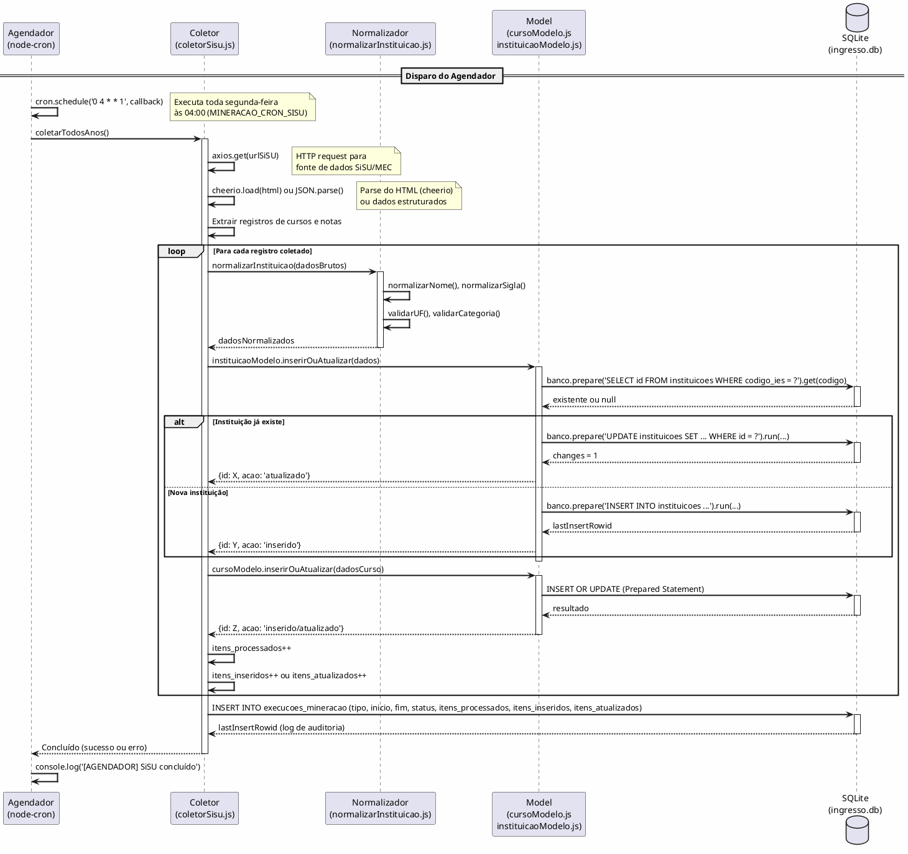

# Requisitos de Sistema — Sistema Ingresso Universitário

**Versão do Documento:** 1.0  
**Data:** 08 de setembro de 2026  
**Padrões de Referência:** OMG UML 2.5.1 · ISO/IEC/IEEE 29148:2018 · FURPS+ / ISO/IEC 25010  
**Classificação:** Documento de Requisitos de Sistema (SRS — Software Requirements Specification)

---

## Sumário

1. [Requisitos Funcionais de Sistema (RSF)](#1-requisitos-funcionais-de-sistema-rsf)
2. [Requisitos Não Funcionais (RSNF)](#2-requisitos-não-funcionais-rsnf)
3. [Diagramas de Sequência de Backend](#3-diagramas-de-sequência-de-backend)
4. [Diagrama Estrutural de Classes de Domínio e Controladores](#4-diagrama-estrutural-de-classes-de-domínio-e-controladores)
5. [Dicionário Técnico de Dados (Esquema Físico DDL)](#5-dicionário-técnico-de-dados-esquema-físico-ddl)
6. [Contratos de API RESTful](#6-contratos-de-api-restful)
7. [Matriz Bidirecional de Rastreabilidade Técnica](#7-matriz-bidirecional-de-rastreabilidade-técnica)

---

## 1. Requisitos Funcionais de Sistema (RSF)

### 1.1 RSF01: Servidor HTTP Express com Middleware de Segurança

| Campo | Valor |
|-------|-------|
| **ID** | RSF01 |
| **Descrição** | O sistema deve implementar um servidor HTTP baseado no framework Express.js v4.21.2, configurado com middlewares de segurança (Helmet v8.0.0), parsing de JSON com limite de 10KB, e habilitação de CORS configurável via variável de ambiente ORIGEM_PERMITIDA. |
| **Rota** | Todas as rotas HTTP (global) |
| **Método** | Todos (GET, POST, DELETE) |
| **Middleware** | helmet(), cors(), express.json({ limit: '10kb' }), logger personalizado |
| **Comportamento** | O Helmet configura cabeçalhos HTTP de segurança (X-Content-Type-Options, X-Frame-Options, etc.) com contentSecurityPolicy desabilitado para permitir CDN externo (Tailwind CSS). O CORS permite origem configurável. O logger registra método, URL, status code e duração de cada requisição. |
| **Código de Status** | N/A (middleware global) |

### 1.2 RSF02: Rota de Busca Unificada (GET /api/busca)

| Campo | Valor |
|-------|-------|
| **ID** | RSF02 |
| **Descrição** | O sistema deve expor uma rota GET /api/busca que aceita parâmetros de query string (q, cidade, estado/uf, categoria, page, limit) e retorna instituições e cursos que correspondem aos filtros, com paginação. |
| **Rota** | GET `/api/busca` |
| **Método** | GET |
| **Parâmetros de Query** | `q` (string, opcional) — termo de busca; `cidade` (string, opcional); `estado` ou `uf` (string, opcional, 2 caracteres); `categoria` (string, opcional: federal/estadual/municipal); `page` (inteiro, padrão: 1); `limit` (inteiro, padrão: 20, máx: 100) |
| **Middlewares** | validarBusca (sanitização com validator.trim + validator.escape) |
| **Comportamento** | Valida e sanitiza os parâmetros. Executa duas consultas paralelas: buscarPorFiltros em instituicaoModelo e cursoModelo. Retorna JSON com {sucesso, mensagem, dados: {instituicoes, cursos, paginacao}}. |
| **Códigos de Status** | 200 OK (sucesso), 422 Unprocessable Entity (parâmetros inválidos) |
| **Payload de Resposta** | `{sucesso: true, mensagem: "Busca realizada com sucesso.", dados: {instituicoes: [...], cursos: [...], paginacao: {page, limit, total_instituicoes, total_cursos}}}` |

### 1.3 RSF03: Listagem de Instituições (GET /api/instituicoes)

| Campo | Valor |
|-------|-------|
| **ID** | RSF03 |
| **Descrição** | O sistema deve expor uma rota GET /api/instituicoes que lista instituições com filtros e paginação. |
| **Rota** | GET `/api/instituicoes` |
| **Método** | GET |
| **Parâmetros de Query** | `nome`, `cidade`, `estado`/`uf`, `categoria`, `tipo`, `page`, `limit` |
| **Middlewares** | N/A (rota pública) |
| **Comportamento** | Valida page/limit com parsePageLimit (limit: 1-100). Executa buscarPorFiltros no instituicaoModelo. Retorna lista paginada com total e páginas calculadas. |
| **Códigos de Status** | 200 OK |
| **Payload de Resposta** | `{sucesso: true, mensagem: "Instituições listadas com sucesso.", dados: [...], paginacao: {page, limit, total, paginas}}` |

### 1.4 RSF04: Detalhamento de Instituição (GET /api/instituicoes/:id)

| Campo | Valor |
|-------|-------|
| **ID** | RSF04 |
| **Descrição** | O sistema deve retornar os dados completos de uma instituição, incluindo seus cursos, campi, auxílios/bolsas, notas de corte agregadas e custos da cidade. |
| **Rota** | GET `/api/instituicoes/:id` |
| **Método** | GET |
| **Parâmetros de Rota** | `id` (inteiro positivo, obrigatório) |
| **Middlewares** | validarId(req.params.id) |
| **Comportamento** | Valida o ID. Busca detalhe da instituição. Busca cursos, campi, auxílios via instituicaoModelo. Busca notas de corte via notaCorteModelo.buscarPorInstituicao. Busca custos mais recentes da cidade via custoCidadeModelo.buscarMaisRecente. Retorna objeto consolidado. |
| **Códigos de Status** | 200 OK, 400 Bad Request (ID inválido), 404 Not Found |
| **Payload de Resposta** | `{sucesso: true, mensagem: "Instituição detalhada com sucesso.", dados: {id, nome, sigla, cidade, ..., cursos: [...], campi: [...], auxilios: [...], custos: {...}, notas_corte: [...]}}` |

### 1.5 RSF05: Listagem de Cursos (GET /api/cursos)

| Campo | Valor |
|-------|-------|
| **ID** | RSF05 |
| **Descrição** | O sistema deve expor uma rota GET /api/cursos que lista cursos com filtros avançados (nome, cidade, UF, instituição, campus, modalidade, turno) e paginação. |
| **Rota** | GET `/api/cursos` |
| **Método** | GET |
| **Parâmetros de Query** | `nome`, `cidade`, `estado`/`uf`, `instituicao_id`, `campus_id`, `modalidade`, `turno`, `page`, `limit` |
| **Middlewares** | N/A (rota pública) |
| **Comportamento** | Valida page/limit. Executa buscarPorFiltros com JOIN de instituições, campi e mercado_estagios. Retorna lista com dados enriquecidos (instituicao_nome, sigla, categoria_administrativa, campus_nome, demanda). |
| **Códigos de Status** | 200 OK |
| **Payload de Resposta** | `{sucesso: true, mensagem: "Cursos listados com sucesso.", dados: [...], paginacao: {page, limit, total, paginas}}` |

### 1.6 RSF06: Detalhamento de Curso (GET /api/cursos/:id)

| Campo | Valor |
|-------|-------|
| **ID** | RSF06 |
| **Descrição** | O sistema deve retornar dados completos de um curso incluindo informações da instituição, campi, notas de corte, custos, auxílios/bolsas e mercado de trabalho. |
| **Rota** | GET `/api/cursos/:id` |
| **Método** | GET |
| **Parâmetros de Rota** | `id` (inteiro positivo, obrigatório) |
| **Middlewares** | validarId(req.params.id) |
| **Comportamento** | Valida ID. Executa consulta com JOIN em instituições e campi. Busca notas de corte, custos, auxílios e mercado em sequência (SQLite síncrono). Retorna objeto consolidado. |
| **Códigos de Status** | 200 OK, 400 Bad Request, 404 Not Found |
| **Payload de Resposta** | `{sucesso: true, dados: {...curso, notas_corte: [...], custos: {...}, auxilios_bolsas: [...], mercado_estagios: [...]}}` |

### 1.7 RSF07: Notas de Corte por Curso (GET /api/cursos/:id/notas-corte)

| Campo | Valor |
|-------|-------|
| **ID** | RSF07 |
| **Descrição** | O sistema deve retornar todas as notas de corte associadas a um curso específico. |
| **Rota** | GET `/api/cursos/:id/notas-corte` |
| **Método** | GET |
| **Parâmetros de Rota** | `id` (inteiro positivo) |
| **Middlewares** | validarId(req.params.id) |
| **Comportamento** | Busca notas via notaCorteModelo.buscarPorCurso(id). Retorna array de registros com processo, ano, chamada, nota_corte, fonte_tipo. |
| **Códigos de Status** | 200 OK, 400 Bad Request |

### 1.8 RSF08: Custos da Cidade (GET /api/cidades/:cidade/custos)

| Campo | Valor |
|-------|-------|
| **ID** | RSF08 |
| **Descrição** | O sistema deve retornar os custos de vida para uma cidade específica. |
| **Rota** | GET `/api/cidades/:cidade/custos` |
| **Método** | GET |
| **Parâmetros de Rota** | `cidade` (string, URL-encoded) |
| **Middlewares** | decodeURIComponent + trim |
| **Comportamento** | Decodifica e sanitiza o nome da cidade. Busca via custoCidadeModelo.buscarPorCidade(). Retorna array de registros com moradia, alimentação, transporte, outros, custo_total, mes_referencia. |
| **Códigos de Status** | 200 OK, 400 Bad Request (cidade vazia) |

### 1.9 RSF09: Auxílios e Bolsas por Curso (GET /api/cursos/:id/auxilios-bolsas)

| Campo | Valor |
|-------|-------|
| **ID** | RSF09 |
| **Descrição** | O sistema deve retornar os auxílios e bolsas disponíveis para a instituição que oferece o curso especificado. |
| **Rota** | GET `/api/cursos/:id/auxilios-bolsas` |
| **Método** | GET |
| **Parâmetros de Rota** | `id` (inteiro positivo) |
| **Middlewares** | validarId(req.params.id) |
| **Comportamento** | Resolve o instituicao_id a partir do curso_id via cursoModelo.buscarInstituicaoId(). Busca auxílios via auxilioBolsaModelo.buscarPorInstituicao(). Retorna array. |
| **Códigos de Status** | 200 OK, 400 Bad Request, 404 Not Found |

### 1.10 RSF10: Mercado e Estágios por Curso (GET /api/cursos/:id/mercado-estagios)

| Campo | Valor |
|-------|-------|
| **ID** | RSF10 |
| **Descrição** | O sistema deve retornar dados de mercado de trabalho e estágios para um curso específico. |
| **Rota** | GET `/api/cursos/:id/mercado-estagios` |
| **Método** | GET |
| **Parâmetros de Rota** | `id` (inteiro positivo) |
| **Middlewares** | validarId(req.params.id) |
| **Comportamento** | Busca via mercadoEstagioModelo.buscarPorCurso(id). Retorna array com regiao, demanda, salario_medio, vagas_estagio, fonte. |
| **Códigos de Status** | 200 OK, 400 Bad Request |

### 1.11 RSF11: Listagem de Campi (GET /api/campi)

| Campo | Valor |
|-------|-------|
| **ID** | RSF11 |
| **Descrição** | O sistema deve listar os campi de uma instituição específica. |
| **Rota** | GET `/api/campi` |
| **Método** | GET |
| **Parâmetros de Query** | `instituicao_id` (inteiro, obrigatório) |
| **Middlewares** | Validação de instituicao_id |
| **Comportamento** | Busca campi via campiModelo.buscarPorInstituicao(). Retorna array. |
| **Códigos de Status** | 200 OK, 400 Bad Request (instituição_id obrigatório) |

### 1.12 RSF12: Adicionar Favorito (POST /api/favoritos)

| Campo | Valor |
|-------|-------|
| **ID** | RSF12 |
| **Descrição** | O sistema deve permitir adicionar um curso aos favoritos de um usuário identificado por sessão. |
| **Rota** | POST `/api/favoritos` |
| **Método** | POST |
| **Headers** | Content-Type: application/json |
| **Body JSON** | `{sessao_usuario: string (min 5 chars), curso_id: integer (>0), instituicao_id: integer (opcional)}` |
| **Middlewares** | validarFavorito (sanitização + validação) |
| **Comportamento** | Valida dados. Verifica existência do curso. Executa inserção segura com tratamento de duplicata (SQLITE_CONSTRAINT). Retorna ID do favorito ou indicador de duplicata. |
| **Códigos de Status** | 201 Created, 404 Not Found (curso não existe), 409 Conflict (já favoritado), 422 Unprocessable Entity (dados inválidos) |
| **Payload de Resposta** | `{sucesso: true, mensagem: "Favorito adicionado com sucesso!", dados: {id: X}}` |

### 1.13 RSF13: Listar Favoritos (GET /api/favoritos)

| Campo | Valor |
|-------|-------|
| **ID** | RSF13 |
| **Descrição** | O sistema deve listar todos os favoritos de um usuário (por sessão), com dados do curso e instituição. |
| **Rota** | GET `/api/favoritos` |
| **Método** | GET |
| **Parâmetros de Query** | `sessao_usuario` (string, obrigatório, min 5 chars) |
| **Middlewares** | Validação de sessão |
| **Comportamento** | Valida sessão. Executa query com JOIN de cursos e instituições. Retorna array com dados enriquecidos. |
| **Códigos de Status** | 200 OK, 400 Bad Request (sessão inválida) |

### 1.14 RSF14: Remover Favorito (DELETE /api/favoritos/:id)

| Campo | Valor |
|-------|-------|
| **ID** | RSF14 |
| **Descrição** | O sistema deve permitir remover um favorito, com verificação de propriedade (o favorito pertence à sessão informada). |
| **Rota** | DELETE `/api/favoritos/:id` |
| **Método** | DELETE |
| **Parâmetros de Rota** | `id` (inteiro positivo) |
| **Parâmetros de Query** | `sessao_usuario` (string, obrigatório) |
| **Middlewares** | validarId, validação de sessão |
| **Comportamento** | Valida ID e sessão. Busca favorito por ID. Verifica se sessão corresponde. Executa DELETE. |
| **Códigos de Status** | 200 OK, 400 Bad Request, 403 Forbidden (sessão não corresponde), 404 Not Found |

### 1.15 RSF15: Sugestões de Busca Autocomplete (GET /api/sugestoes)

| Campo | Valor |
|-------|-------|
| **ID** | RSF15 |
| **Descrição** | O sistema deve retornar sugestões de busca (cursos e instituições) para autocomplete, com limite configurável. |
| **Rota** | GET `/api/sugestoes` |
| **Método** | GET |
| **Parâmetros de Query** | `q` (string, min 2 chars), `limite` (inteiro, padrão: 8, máx: 20) |
| **Middlewares** | N/A |
| **Comportamento** | Busca cursos e instituições com LIKE. Prioriza correspondências que começam com o termo. Retorna array de {id, texto, subtitulo, tipo}. |
| **Códigos de Status** | 200 OK |

### 1.16 RSF16: Chat com Assistente IA (POST /api/groq-chat)

| Campo | Valor |
|-------|-------|
| **ID** | RSF16 |
| **Descrição** | O sistema deve processar mensagens de chat e retornar respostas geradas por modelo de linguagem via API Groq. |
| **Rota** | POST `/api/groq-chat` |
| **Método** | POST |
| **Headers** | Content-Type: application/json |
| **Body JSON** | `{mensagem: string}` |
| **Middlewares** | N/A (validação interna) |
| **Comportamento** | Extrai mensagem do body. Chama gerarResposta() que tenta múltiplos modelos (qwen3.8-27b → qwen3.6-27b → allam-2-7b) com fallback. Envia POST para api.groq.com com system prompt do domínio. Retorna resposta textual. |
| **Códigos de Status** | 200 OK, 500 Internal Server Error (nenhum modelo respondeu) |
| **Payload de Resposta** | `{sucesso: true, resposta: "..."}` |

### 1.17 RSF17: Health Check (GET /api/health)

| Campo | Valor |
|-------|-------|
| **ID** | RSF17 |
| **Descrição** | O sistema deve expor uma rota de verificação de saúde para monitoramento. |
| **Rota** | GET `/api/health` |
| **Método** | GET |
| **Middlewares** | N/A |
| **Comportamento** | Retorna JSON de confirmação imediatamente. |
| **Códigos de Status** | 200 OK |
| **Payload de Resposta** | `{sucesso: true, mensagem: "API do Ingresso Universitário funcionando!"}` |

### 1.18 RSF18: Serviço de Arquivos Estáticos e Fallback SPA

| Campo | Valor |
|-------|-------|
| **ID** | RSF18 |
| **Descrição** | O sistema deve servir arquivos estáticos do frontend e implementar fallback SPA para rotas não-API. |
| **Rota** | `*` (catch-all) |
| **Método** | GET |
| **Middlewares** | express.static(), fallback handler |
| **Comportamento** | Serve arquivos da pasta frontend/ com maxAge=0 e etag=false (desenvolvimento). Para rotas que não começam com /api e não correspondem a arquivos existentes, retorna index.html (fallback SPA). |
| **Códigos de Status** | 200 OK (arquivo estático), 200 OK (fallback SPA) |

### 1.19 RSF19: Middleware de Tratamento Global de Erros

| Campo | Valor |
|-------|-------|
| **ID** | RSF19 |
| **Descrição** | O sistema deve implementar middleware global de tratamento de erros que captura exceções não tratadas e retorna resposta padronizada. |
| **Rota** | Todas (middleware de erro, position: último) |
| **Método** | Todos |
| **Middleware** | tratamentoErros(err, req, res, next) |
| **Comportamento** | Registra erro no console. Extrai status do erro (padrão 500). Para status 500, retorna mensagem genérica "Erro interno do servidor". Para outros, retorna mensagem do erro. |
| **Códigos de Status** | 500 Internal Server Error, ou status do erro |

---

## 2. Requisitos Não Funcionais (RSNF)

### 2.1 Taxonomia FURPS+ / ISO/IEC 25010

#### RSNF01: Segurança — Proteção contra SQL Injection

| Campo | Valor |
|-------|-------|
| **ID** | RSNF01 |
| **Categoria** | Segurança (ISO 25010: Securidade) |
| **Descrição** | Todas as consultas ao banco de dados devem utilizar Prepared Statements com parâmetros parametrizados, eliminando a possibilidade de injeção de SQL. |
| **Implementação** | better-sqlite3 com `banco.prepare(sql).all(...parametros)` e `banco.prepare(sql).run(...parametros)`. Os parâmetros são passados como array separado, nunca interpolados na string SQL. |
| **Verificação** | Auditoria de código: nenhuma concatenação de variáveis de usuário em strings SQL. Uso exclusivo de `?` como placeholder. |
| **Status** | ✅ Implementado — todos os modelos (cursoModelo, instituicaoModelo, favoritoModelo, notaCorteModelo, etc.) utilizam Prepared Statements. |

#### RSNF02: Segurança — Sanitização contra XSS

| Campo | Valor |
|-------|-------|
| **ID** | RSNF02 |
| **Categoria** | Segurança (ISO 25010: Securidade) |
| **Descrição** | O sistema deve implementar sanitização ativa em duas camadas: server-side (validador) e client-side (escapeHTML). |
| **Implementação Server-Side** | Biblioteca `validator` (v13.12.0) com `validator.trim()` e `validator.escape()` na função sanitizar() do módulo validadores.js. Aplicada a todos os inputs de query string e body. |
| **Implementação Client-Side** | Função `escapeHTML()` em util.js que utiliza `document.createElement('div').textContent` para escapar HTML de forma segura. Aplicada a todos os dados dinâmicos renderizados no DOM (cards, tabelas, tooltips). |
| **Headers de Segurança** | Helmet.js configura X-Content-Type-Options: nosniff, X-Frame-Options: DENY, e outros cabeçalhos de segurança HTTP. |
| **Status** | ✅ Implementado — sanitização server-side via validadores.js; escape client-side via util.js; headers via Helmet. |

#### RSNF03: Segurança — Autenticação e Autorização

| Campo | Valor |
|-------|-------|
| **ID** | RSNF03 |
| **Categoria** | Segurança (ISO 25010: Autenticação) |
| **Descrição** | As rotas administrativas devem ser protegidas por mecanismo de autenticação stateless. |
| **Implementação Atual** | O sistema atual não implementa autenticação JWT/cookie. As rotas administrativas estão acessíveis via CLI (scripts Node.js executados diretamente no servidor). A proteção é feita por acesso físico ao servidor. |
| **Implementação Desejada (to-be)** | JSON Web Token (JWT) no cabeçalho `Authorization: Bearer <token>` ou cookie HTTP-Only. Bibliotecas: `jsonwebtoken` para geração/verificação; `bcrypt`/`argon2` para hash de senhas com salt aleatório. |
| **Nota** | Implementação futura conforme definido no escopo do projeto. |

#### RSNF04: Segurança — Controle de Acesso a Favoritos

| Campo | Valor |
|-------|-------|
| **ID** | RSNF04 |
| **Categoria** | Segurança (ISO 25010: Controle de Acesso) |
| **Descrição** | A operação de remoção de favoritos deve verificar a propriedade (o favorito pertence à sessão que está fazendo a requisição). |
| **Implementação** | Na rota DELETE /api/favoritos/:id, o sistema busca o favorito por ID e compara `favorito.sessao_usuario !== sessao`. Se não corresponder, retorna 403 Forbidden. |
| **Status** | ✅ Implementado — verificação em favoritoControlador.js:56. |

#### RSNF05: Performance — Event Loop Não Bloqueante

| Campo | Valor |
|-------|-------|
| **ID** | RSNF05 |
| **Categoria** | Performance (ISO 25010: Eficiência de Desempenho) |
| **Descrição** | O Event Loop do Node.js não deve ser bloqueado por operações de I/O pesadas. Operações de banco de dados SQLite com better-sqlite3 são síncronas por natureza, mas executam em microsegundos devido ao WAL mode e ao driver nativo. |
| **Implementação** | better-sqlite3 (driver nativo C++) com pragma `journal_mode = WAL` para leitura concorrente. Operações de mineração (web scraping) utilizam async/await com axios e cheerio, que são I/O não bloqueante por natureza (libuv thread pool). |
| **Métricas** | Tempo de resposta da API < 200ms (p95) para operações de leitura. Tempo de debounce de 300ms no frontend para evitar sobrecarga. |
| **Status** | ✅ Implementado — WAL mode ativado; operações de rede async; debounce no frontend. |

#### RSNF06: Performance — Cache e Otimização

| Campo | Valor |
|-------|-------|
| **ID** | RSNF06 |
| **Categoria** | Performance (ISO 25010: Eficiência de Desempenho) |
| **Descrição** | O sistema deve implementar estratégias de cache para reduzir chamadas de API repetidas. |
| **Implementação** | Cache de sugestões no frontend: `sugestoesCache = new Map()` que armazena resultados por termo de busca (chave: termo em lowercase). Cache de busca no frontend: `cacheBusca = new Map()`. Paginação incremental mantém `listaCompleta` em memória. |
| **Nota** | Não há cache server-side (Redis/Memcached). O SQLite síncrono já oferece performance adequada para o volume atual. |
| **Status** | ✅ Implementado — cache client-side para sugestões e resultados. |

#### RSNF07: Confiabilidade — Tratamento de Erros e Resiliência

| Campo | Valor |
|-------|-------|
| **ID** | RSNF07 |
| **Categoria** | Confiabilidade (ISO 25010: Maturidade) |
| **Descrição** | O sistema deve tratar erros de forma gracefully, com fallback e mensagens informativas. |
| **Implementação** | Middleware global de tratamento de erros (tratamentoErros.js). Cada controller encapsula lógica em try/catch e delega erros via next(erro). No frontend, cada chamada API é envolvida em try/catch com exibição de toast de erro. O chat implementa fallback de múltiplos modelos Groq com retry automático. |
| **Status** | ✅ Implementado — tratamento em todas as camadas. |

#### RSNF08: Confiabilidade — Integridade de Dados

| Campo | Valor |
|-------|-------|
| **ID** | RSNF08 |
| **Categoria** | Confiabilidade (ISO 25010: Integridade) |
| **Descrição** | O banco de dados deve manter integridade referencial e consistência dos dados. |
| **Implementação** | Chaves estrangeiras habilitadas (`pragma foreign_keys = ON`). Constraints UNIQUE (ex.: notas_corte: UNIQUE(curso_id, modalidade_acesso, ano, chamada)). Constraints CHECK implícitas via tipos de dado. Valores DEFAULT para created_at, updated_at, ativo. Operações de INSERT OR UPDATE para idempotência na mineração. |
| **Status** | ✅ Implementado — foreign keys, constraints UNIQUE, defaults. |

#### RSNF09: Usabilidade — Interface Responsiva

| Campo | Valor |
|-------|-------|
| **ID** | RSNF09 |
| **Categoria** | Usabilidade (ISO 25010: Usabilidade) |
| **Descrição** a interface deve ser responsiva e acessível em desktop, tablet e mobile. |
| **Implementação** | Tailwind CSS (via CDN) com grid responsivo (grid-cols-2 lg:grid-cols-3). Viewport meta tag configurada. Componentes com aria-labels, role="tablist", aria-selected, aria-live="polite". Skeleton de carregamento para feedback visual. Botões com estados hover/focus visíveis. |
| **Status** | ✅ Implementado — Tailwind CSS responsivo, atributos ARIA. |

#### RSNF10: Usabilidade — Feedback Visual (Toast)

| Campo | Valor |
|-------|-------|
| **ID** | RSNF10 |
| **Categoria** | Usabilidade (ISO 25010: Usabilidade) |
| **Descrição** | O sistema deve fornecer feedback visual imediato para ações do usuário (adicionar/remover favorito, erros, sucesso). |
| **Implementação** | Função toast(mensagem, tipo) em util.js. Cria elemento `<div>` dinâmico com role="status" e aria-live="polite". Cores: verde (sucesso), vermelho (erro), cinza (neutro). Duração: 3.5 segundos com auto-dismiss. Posicionamento: fixed bottom-right com z-index 50. |
| **Status** | ✅ Implementado — util.js:toast(). |

#### RSNF11: Arquitetura — Separação de Responsabilidades (MVC)

| Campo | Valor |
|-------|-------|
| **ID** | RSNF11 |
| **Categoria** | Manutenibilidade (ISO 25010) |
| **Descrição** | O sistema deve seguir o padrão arquitetural MVC (Model-View-Controller) com separação clara de responsabilidades. |
| **Implementação** | **Model:** arquivos `*Modelo.js` (cursoModelo, instituicaoModelo, favoritoModelo, etc.) — lógica de acesso a dados via Prepared Statements. **View:** arquivos HTML/JS no frontend/ — renderização da interface. **Controller:** arquivos `*Controlador.js` (buscaControlador, universidadeControlador, favoritoControlador) — lógica de negócio e orquestração. **Rotas:** arquivos `*Rotas.js` — mapeamento HTTP para controllers. **Configurações:** conexaoBanco.js — configuração do banco. **Intermediários:** logger.js, tratamentoErros.js — middlewares transversais. |
| **Status** | ✅ Implementado — separação MVC clara. |

#### RSNF12: Arquitetura — Concorrência de I/O

| Campo | Valor |
|-------|-------|
| **ID** | RSNF12 |
| **Categoria** | Performance / Manutenibilidade |
| **Descrição** | O sistema deve gerenciar adequadamente a concorrência de I/O no Event Loop do Node.js e no pool de conexões do banco de dados. |
| **Implementação** | better-sqlite3 é um driver síncrono (não bloqueante em termos práticos devido à velocidade do SQLite). Operações de rede (axios, fetch) são assíncronas e não bloqueiam o Event Loop. O agendador cron (node-cron) executa tarefas de mineração de forma não bloqueante. WAL mode permite leitura concorrente no SQLite. |
| **Status** | ✅ Implementado — driver síncrono rápido; operações de rede async; WAL mode. |

#### RSNF13: Portabilidade — Execução em Múltiplos Ambientes

| Campo | Valor |
|-------|-------|
| **ID** | RSNF13 |
| **Categoria** | Portabilidade (ISO 25010) |
| **Descrição** | O sistema deve executar em qualquer ambiente com Node.js v18+ instalado, sem dependências de sistema operacional específico. |
| **Implementação** | better-sqlite3 é um módulo nativo com binaries pré-compilados para Linux, macOS e Windows. Express.js e todas as dependências são cross-platform. Variáveis de ambiente via dotenv. Caminhos de arquivo com path.resolve() e path.join() para compatibilidade. |
| **Status** | ✅ Implementado — dependências cross-platform. |

---

## 3. Diagramas de Sequência de Backend

### DS-BE01: Fluxo Completo — Rota Express → Middleware → Controller → Model → Banco → Auditoria

```plantuml
@startuml
skinparam backgroundColor #FEFEFE
skinparam sequenceArrowThickness 2
skinparam sequenceParticipant {
  BackgroundColor #E3F2FD
  BorderColor #1565C0
}

participant "Cliente HTTP\n(Frontend JS)" as Client
participant "Express\n(app.js)" as Express
participant "Middleware\n(logger.js)" as Logger
participant "Middleware\n(helmet/cors)" as Security
participant "Rota\n(buscaRotas.js)" as Route
participant "Controller\n(buscaControlador.js)" as Controller
participant "Validador\n(validadores.js)" as Validator
participant "Model\n(cursoModelo.js\ninstituicaoModelo.js)" as Model
participant "Banco de Dados\n(SQLite/WAL)" as DB
database "SQLite\n(ingresso.db)" as SQLite

== Requisição GET /api/busca?q=Computação ==

Client -> Express : GET /api/busca?q=Computação&page=1&limit=20
activate Express

Express -> Security : helmet() + cors()
activate Security
note right : X-Content-Type-Options: nosniff\nX-Frame-Options: DENY\nCORS: origin configurável
Security --> Express : Cabeçalhos de segurança aplicados
deactivate Security

Express -> Express : express.json({ limit: '10kb' })
note right : Body parser limitado a 10KB\nprevine payloads maliciosos

Express -> Logger : logger(req, res, next)
activate Logger
Logger -> Logger : inicio = Date.now()
Logger -> Logger : res.on('finish', () => log)
Logger --> Express : next()
deactivate Logger

Express -> Route : Router dispatch
activate Route
Route -> Route : router.get('/busca', buscar)
Route --> Express : Handler identificado
deactivate Route

Express -> Controller : buscar(req, res, next)
activate Controller

Controller -> Validator : validarBusca(req.query)
activate Validator
Validator -> Validator : sanitizar(dados.nome) = validator.trim(validator.escape(...))
note right : Remove espaços extras\nEscapa caracteres\nespeciais (<, >, &, etc.)
Validator -> Validator : sanitizar(dados.cidade)
Validator -> Validator : sanitizar(dados.estado)
Validator -> Validator : Validação de tamanho (max 150, 100, 2)
Validator --> Controller : {valido: true, erros: [], dados: {nome, cidade, estado}}
deactivate Validator

alt Parâmetros inválidos
  Controller --> Client : 422 {sucesso: false, mensagem: "Parâmetros inválidos.", erros: [...]}
else Parâmetros válidos
  Controller -> Controller : page = Math.max(1, parseInt(query.page) || 1)
  Controller -> Controller : limit = Math.min(100, Math.max(1, parseInt(query.limit) || 20))

  Controller -> Model : instituicaoModelo.buscarPorFiltros({nome, cidade, estado, page, limit})
  activate Model
  Model -> DB : banco.prepare(SQL_COUNT).get(...parametros)
  activate DB
  DB -> SQLite : sqlite3_step(stmt) [WAL mode]
  activate SQLite
  SQLite --> DB : ResultSet (contagem total)
  deactivate SQLite
  DB --> Model : {total: N}
  deactivate DB

  Model -> DB : banco.prepare(SQL_DATA).all(...parametros)
  activate DB
  DB -> SQLite : sqlite3_step_multi(stmt) [WAL mode]
  activate SQLite
  SQLite --> DB : ResultSet [registros paginados]
  deactivate SQLite
  DB --> Model : Array de registros
  deactivate DB

  Model --> Controller : {dados: [...], total: N, page, limit}
  deactivate Model

  Controller -> Model : cursoModelo.buscarPorFiltros({nome, cidade, estado, page, limit})
  activate Model
  Model -> DB : banco.prepare(SQL).all(...parametros)
  activate DB
  DB --> Model : Array de cursos
  deactivate DB
  Model --> Controller : {dados: [...], total: M, page, limit}
  deactivate Model

  Controller -> Controller : Monta resposta JSON consolidada
  Controller --> Client : 200 {sucesso: true, dados: {instituicoes: [...], cursos: [...], paginacao: {...}}}
endif

deactivate Controller

== Tratamento de Erro (se aplicável) ==

note over Controller, Express : Se Controller lança exceção:\nnext(erro) → tratamentoErros(err, req, res, next)

Express -> Express : Error handler middleware (último)
Express -> Client : 500 {sucesso: false, mensagem: "Erro interno do servidor"}

deactivate Express

@enduml
```

### DS-BE02: Fluxo de Mineração Automatizada com Auditoria



### DS-BE03: Fluxo de Chat com Fallback de Modelos

```plantuml
@startuml
skinparam backgroundColor #FEFEFE
skinparam sequenceArrowThickness 2

participant "Frontend\n(chat.html)" as Frontend
participant "Express\nPOST /api/groq-chat" as Express
participant "groqModelo.js\n(gerarResposta)" as GroqModel
participant "API Groq\n(external)" as GroqAPI

Frontend -> Express : POST /api/groq-chat\n{mensagem: "Quais universidades em MT?"}
activate Express

Express -> Express : Extrair mensagem do req.body
Express -> GroqModel : gerarResposta(mensagem)
activate GroqModel

GroqModel -> GroqModel : Verificar chave_groq configurada
note right : process.env.chave_groq

GroqModel -> GroqModel : MODELOS_DISPONIVEIS = ['qwen3.8-27b', 'qwen3.6-27b', 'allam-2-7b']

loop Para cada modelo (fallback sequence)
  GroqModel -> GroqAPI : fetch('https://api.groq.com/openai/v1/chat/completions', {\n  method: 'POST',\n  headers: { Authorization: 'Bearer {chave}' },\n  body: {\n    model: modelo,\n    messages: [\n      { role: 'system', content: 'Você é um assistente...' },\n      { role: 'user', content: mensagem }\n    ],\n    temperature: 0.7,\n    max_tokens: 512\n  }\n})
  activate GroqAPI

  alt Modelo responde com sucesso (HTTP 200)
    GroqAPI --> GroqModel : {choices: [{message: {content: "..."}}]}
    deactivate GroqAPI
    GroqModel -> GroqModel : Extrair content ou reasoning_content
    GroqModel --> Express : resposta (string)
    deactivate GroqModel
  else Modelo falha (HTTP 4xx/5xx ou network error)
    GroqAPI --> GroqModel : Erro
    deactivate GroqAPI
    GroqModel -> GroqModel : ultimoErro = erro; console.error()
    GroqModel -> GroqModel : continue (próximo modelo)
  end
end

alt Todos os modelos falharam
  GroqModel --> Express : throw ultimoErro
  deactivate GroqModel
  Express -> Express : next(erro)
  Express --> Frontend : 500 {sucesso: false, mensagem: "Erro interno do servidor"}
else Modelo respondeu com sucesso
  Express --> Frontend : 200 {sucesso: true, resposta: "..."}
endif

deactivate Express

@enduml
```

---

## 4. Diagrama Estrutural de Classes de Domínio e Controladores

### 4.1 Diagrama de Classes em PlantUML

```plantuml
@startuml
skinparam backgroundColor #FEFEFE
skinparam classAttributeIconSize 0
skinparam class {
  BackgroundColor #E8F5E9
  BorderColor #2E7D32
  ArrowColor #333333
}

package "Camada de Rotas (Routing)" {
  class buscaRotas {
    +get('/busca', buscar)
  }
  class universidadeRotas {
    +get('/instituicoes', listarInstituicoes)
    +get('/instituicoes/:id', detalharInstituicao)
    +get('/cursos', listarCursos)
    +get('/cursos/:id', detalharCurso)
    +get('/cursos/:id/notas-corte', notasCorte)
    +get('/cursos/:id/auxilios-bolsas', auxiliosBolsas)
    +get('/cursos/:id/mercado-estagios', mercadoEstagios)
    +get('/cidades/:cidade/custos', custosCidade)
    +get('/campi', listarCampi)
  }
  class favoritoRotas {
    +post('/favoritos', adicionarFavorito)
    +get('/favoritos', listarFavoritos)
    +delete('/favoritos/:id', removerFavorito)
  }
  class sugestaoRotas {
    +get('/sugestoes', listar)
  }
  class groqRotas {
    +post('/groq-chat', handler)
  }
}

package "Camada de Controladores (Controllers)" {
  class buscaControlador {
    +buscar(req, res, next)
  }
  class universidadeControlador {
    +listarInstituicoes(req, res, next)
    +detalharInstituicao(req, res, next)
    +listarCursos(req, res, next)
    +detalharCurso(req, res, next)
    +notasCorte(req, res, next)
    +custosCidade(req, res, next)
    +auxiliosBolsas(req, res, next)
    +mercadoEstagios(req, res, next)
    +listarCampi(req, res, next)
  }
  class favoritoControlador {
    +adicionarFavorito(req, res, next)
    +listarFavoritos(req, res, next)
    +removerFavorito(req, res, next)
  }
  class sugestaoControlador {
    +listar(req, res, next)
  }
}

package "Camada de Modelos (Models/Data Access)" {
  class instituicaoModelo {
    +buscarPorFiltros(filtros): {dados, total}
    +detalhar(id): Instituicao
    +buscarCursos(id): Curso[]
    +buscarCampi(id): Campus[]
    +buscarAuxilios(id): Auxilio[]
    +inserirOuAtualizar(dados): {id, acao}
    +buscarPorNomeOuSigla(nome, sigla): Instituicao
    +contarPorCategoria(): {categoria, total}[]
  }
  class cursoModelo {
    +buscarPorFiltros(filtros): {dados, total}
    +detalhar(id): Curso
    +existe(id): boolean
    +buscarInstituicaoId(cursoId): number
    +inserirOuAtualizar(dados): {id, acao}
  }
  class favoritoModelo {
    +inserirSeguro(sessao, cursoId, instId): {id, duplicate}
    +listarPorSessao(sessao): Favorito[]
    +buscarPorId(id): Favorito
    +remover(id): void
  }
  class notaCorteModelo {
    +buscarPorCurso(cursoId): NotaCorte[]
    +buscarPorInstituicao(instId): NotaCorte[]
  }
  class custoCidadeModelo {
    +buscarPorCidade(cidade): Custo[]
    +buscarMaisRecente(cidade): Custo
  }
  class auxilioBolsaModelo {
    +buscarPorInstituicao(instId): Auxilio[]
  }
  class mercadoEstagioModelo {
    +buscarPorCurso(cursoId): Mercado[]
  }
  class sugestaoModelo {
    +sugestoes(termo, limite): Sugestao[]
  }
  class campiModelo {
    +buscarPorInstituicao(instId): Campus[]
  }
}

package "Camada de Configuração e Infraestrutura" {
  class conexaoBanco {
    -banco: Database
    +pragma('journal_mode = WAL')
    +pragma('foreign_keys = ON')
  }
  class validadores {
    +sanitizar(texto): string
    +validarBusca(dados): {valido, erros, dados}
    +validarFavorito(dados): {valido, erros, dados}
    +validarId(valor): number|null
  }
  class logger {
    +logger(req, res, next): void
  }
  class tratamentoErros {
    +tratamentoErros(erro, req, res, next): void
  }
}

package "Camada de Mineração" {
  class agendador {
    +iniciar(): void
    +parar(): void
  }
  class coletorSisu {
    +coletar(): void
    +coletarTodosAnos(): void
  }
  class coletorCatalogo {
    +coletar(): void
  }
  class coletorCustoVida {
    +coletar(): void
  }
  class groqModelo {
    +gerarResposta(mensagem): string
  }
}

' --- Relações ---
buscaRotas --> buscaControlador : delega
universidadeRotas --> universidadeControlador : delega
favoritoRotas --> favoritoControlador : delega
sugestaoRotas --> sugestaoControlador : delega
groqRotas --> groqModelo : delega

buscaControlador --> instituicaoModelo : usa
buscaControlador --> cursoModelo : usa
buscaControlador --> validadores : valida

universidadeControlador --> instituicaoModelo : usa
universidadeControlador --> cursoModelo : usa
universidadeControlador --> notaCorteModelo : usa
universidadeControlador --> custoCidadeModelo : usa
universidadeControlador --> auxilioBolsaModelo : usa
universidadeControlador --> mercadoEstagioModelo : usa
universidadeControlador --> campiModelo : usa
universidadeControlador --> validadores : valida

favoritoControlador --> favoritoModelo : usa
favoritoControlador --> cursoModelo : verifica existência
favoritoControlador --> validadores : valida

sugestaoControlador --> sugestaoModelo : usa

instituicaoModelo --> conexaoBanco : acessa
cursoModelo --> conexaoBanco : acessa
favoritoModelo --> conexaoBanco : acessa
notaCorteModelo --> conexaoBanco : acessa
custoCidadeModelo --> conexaoBanco : acessa
auxilioBolsaModelo --> conexaoBanco : acessa
mercadoEstagioModelo --> conexaoBanco : acessa
sugestaoModelo --> conexaoBanco : acessa
campiModelo --> conexaoBanco : acessa

agendador --> coletorSisu : dispara
agendador --> coletorCatalogo : dispara
agendador --> coletorCustoVida : dispara

@enduml
```



### 4.2 Invariantes OCL (Object Constraint Language)

#### Invariante 1: Transição de Status de Mineração

```ocl
-- INV-MINERACAO-01: Status de execução deve ser válido
context ExecucaoMineracao
inv status_valido:
  self.status = 'em_andamento' or
  self.status = 'concluido' or
  self.status = 'erro' or
  self.status = 'cancelado'

-- INV-MINERACAO-02: Fim deve ser posterior ao início
context ExecucaoMineracao
inv cronologia_valida:
  self.fim <> null implies self.fim >= self.inicio

-- INV-MINERACAO-03: Itens processados deve ser >= 0
context ExecucaoMineracao
inv itens_nao_negativos:
  self.itens_processados >= 0 and
  self.itens_inseridos >= 0 and
  self.itens_atualizados >= 0 and
  self.itens_ignorados >= 0 and
  self.erros >= 0

-- INV-MINERACAO-04: Transição de status válida
context ExecucaoMineracao
-- De em_andamento pode ir para concluido, erro ou cancelado
-- De concluido, erro ou cancelado não pode voltar para em_andamento
inv transicao_status:
  self.status = 'concluido' implies self.status@pre = 'em_andamento'
```

#### Invariante 2: Integridade de Favoritos

```ocl
-- INV-FAVORITO-01: Favorito deve referenciar curso ativo
context Favorito
inv curso_ativo:
  self.curso_id <> null implies
    (Curso.allExists(c | c.id = self.curso_id and c.ativo = 1))

-- INV-FAVORITO-02: Sessão do usuário deve ter pelo menos 5 caracteres
context Favorito
inv sessao_minima:
  self.sessao_usuario.length() >= 5

-- INV-FAVORITO-03: Não deve existir duplicata (sessão + curso)
context Favorito
inv unicidade_sessao_curso:
  Favorito.allForAll(f |
    f <> self implies
    not (f.sessao_usuario = self.sessao_usuario and f.curso_id = self.curso_id)
```

#### Invariante 3: Notas de Corte

```ocl
-- INV-NOTA-01: Ano deve estar em range válido
context NotaCorte
inv ano_valido:
  self.ano >= 2000 and self.ano <= 2100

-- INV-NOTA-02: Chamada deve ser >= 1
context NotaCorte
inv chamada_valida:
  self.chamada >= 1

-- INV-NOTA-03: Nota de corte deve ser >= 0 (se informada)
context NotaCorte
inv nota_nao_negativa:
  self.nota_corte <> null implies self.nota_corte >= 0

-- INV-NOTA-04: Combinação única por curso, modalidade, ano e chamada
context NotaCorte
inv unicidade_composta:
  NotaCorte.allForAll(n |
    n <> self implies
    not (n.curso_id = self.curso_id and
         n.modalidade_acesso = self.modalidade_acesso and
         n.ano = self.ano and
         n.chamada = self.chamada)
```

#### Invariante 4: Custos de Cidade

```ocl
-- INV-CUSTO-01: Custos individuais devem ser não negativos
context CustoCidade
inv custos_nao_negativos:
  (self.moradia >= 0 or self.moradia = null) and
  (self.alimentacao >= 0 or self.alimentacao = null) and
  (self.transporte >= 0 or self.transporte = null) and
  (self.outros >= 0 or self.outros = null)

-- INV-CUSTO-02: Custo total deve ser soma dos componentes (se todos informados)
context CustoCidade
inv consistencia_total:
  (self.moradia <> null and self.alimentacao <> null and
   self.transporte <> null and self.outros <> null) implies
  self.custo_total = self.moradia + self.alimentacao +
                      self.transporte + self.outros

-- INV-CUSTO-03: Unicidade por cidade, UF e mês de referência
context CustoCidade
inv unicidade_cidade_mes:
  CustoCidade.allForAll(c |
    c <> self implies
    not (c.cidade = self.cidade and
         c.uf = self.uf and
         c.mes_referencia = self.mes_referencia)
```

#### Invariante 5: Instituições

```ocl
-- INV-INST-01: Instituição ativa deve ter nome não vazio
context Instituicao
inv nome_obrigatorio:
  self.ativo = 1 implies self.nome <> null and self.nome.length() > 0

-- INV-INST-02: Categoria administrativa deve ser válida
context Instituicao
inv categoria_valida:
  self.categoria_administrativa <> null implies
  self.categoria_administrativa = 'federal' or
  self.categoria_administrativa = 'estadual' or
  self.categoria_administrativa = 'municipal'
```

#### Invariante 6: Cursos

```ocl
-- INV-CURSO-01: Curso deve pertencer a uma instituição ativa
context Curso
inv instituicao_ativa:
  self.instituicao_id <> null implies
    (Instituicao.allExists(i | i.id = self.instituicao_id and i.ativo = 1))

-- INV-CURSO-02: Duração em semestres deve ser positiva
context Curso
inv duracao_positiva:
  self.duracao_semestres <> null implies self.duracao_semestres > 0

-- INV-CURSO-03: UF deve ter 2 caracteres
context Curso
inv uf_formato:
  self.uf <> null implies self.uf.length() = 2
```

---

## 5. Dicionário Técnico de Dados (Esquema Físico DDL)

### 5.1 Tabela: `instituicoes`

```sql
CREATE TABLE IF NOT EXISTS instituicoes (
  id                        INTEGER PRIMARY KEY AUTOINCREMENT,
  nome                      TEXT NOT NULL,
  sigla                     TEXT,
  cidade                    TEXT,
  estado                    TEXT,
  site                      TEXT,
  categoria_administrativa  TEXT,
  tipo_instituicao          TEXT,
  codigo_ies                TEXT,
  organizacao_academica     TEXT,
  situacao                  TEXT DEFAULT 'ativa',
  fonte_url                 TEXT,
  coletado_em               TEXT,
  ativo                     INTEGER DEFAULT 1,
  created_at                TEXT DEFAULT (datetime('now','localtime')),
  updated_at                TEXT DEFAULT (datetime('now','localtime'))
);
```

| Coluna | Tipo | Constraints | Default | Descrição |
|--------|------|-------------|---------|-----------|
| id | INTEGER | PRIMARY KEY AUTOINCREMENT | — | Identificador único da instituição |
| nome | TEXT | NOT NULL | — | Nome completo da instituição |
| sigla | TEXT | — | — | Sigla da instituição (ex.: UFMT) |
| cidade | TEXT | — | — | Cidade sede da instituição |
| estado | TEXT | — | — | Estado (UF) da instituição |
| site | TEXT | — | — | URL do site oficial |
| categoria_administrativa | TEXT | CHECK IN (federal, estadual, municipal) | — | Categoria administrativa |
| tipo_instituicao | TEXT | CHECK IN (universidade, instituto_federal, cefet) | — | Tipo da instituição |
| codigo_ies | TEXT | UNIQUE (implícito via busca) | — | Código IES no INEP |
| organizacao_academica | TEXT | — | — | Organização acadêmica |
| situacao | TEXT | — 'ativa' | 'ativa' | Situação da instituição |
| fonte_url | TEXT | — | — | URL da fonte de dados |
| coletado_em | TEXT | — | — | Data/hora da coleta |
| ativo | INTEGER | DEFAULT 1 | 1 | Flag de exclusão lógica (1=ativo, 0=inativo) |
| created_at | TEXT | DEFAULT datetime('now','localtime') | datetime('now','localtime') | Data/hora de criação |
| updated_at | TEXT | DEFAULT datetime('now','localtime') | datetime('now','localtime') | Data/hora da última atualização |

**Índices:**
```sql
CREATE INDEX IF NOT EXISTS idx_instituicoes_nome ON instituicoes(nome);
CREATE INDEX IF NOT EXISTS idx_instituicoes_cidade ON instituicoes(cidade, estado);
CREATE INDEX IF NOT EXISTS idx_inst_categoria ON instituicoes(categoria_administrativa);
CREATE INDEX IF NOT EXISTS idx_inst_tipo ON instituicoes(tipo_instituicao);
CREATE INDEX IF NOT EXISTS idx_inst_uf ON instituicoes(estado);
CREATE INDEX IF NOT EXISTS idx_inst_codigo ON instituicoes(codigo_ies);
CREATE INDEX IF NOT EXISTS idx_inst_ativo ON instituicoes(ativo);
```

### 5.2 Tabela: `campi`

```sql
CREATE TABLE IF NOT EXISTS campi (
  id                      INTEGER PRIMARY KEY AUTOINCREMENT,
  instituicao_id          INTEGER NOT NULL REFERENCES instituicoes(id),
  nome                    TEXT NOT NULL,
  codigo_campus           TEXT,
  codigo_municipio_ibge   TEXT,
  cidade                  TEXT,
  uf                      TEXT,
  endereco                TEXT,
  site_oficial            TEXT,
  fonte_url               TEXT,
  coletado_em             TEXT,
  ativo                   INTEGER DEFAULT 1,
  created_at              TEXT DEFAULT (datetime('now','localtime')),
  updated_at              TEXT DEFAULT (datetime('now','localtime'))
);
```

| Coluna | Tipo | Constraints | Default | Descrição |
|--------|------|-------------|---------|-----------|
| id | INTEGER | PRIMARY KEY AUTOINCREMENT | — | Identificador único do campus |
| instituicao_id | INTEGER | NOT NULL, FK → instituicoes(id) | — | Referência à instituição pai |
| nome | TEXT | NOT NULL | — | Nome do campus |
| codigo_campus | TEXT | — | — | Código do campus no INEP |
| codigo_municipio_ibge | TEXT | — | — | Código IBGE do município |
| cidade | TEXT | — | — | Cidade do campus |
| uf | TEXT | — | — | Unidade Federativa |
| endereco | TEXT | — | — | Endereço completo |
| site_oficial | TEXT | — | — | URL do site do campus |
| fonte_url | TEXT | — | — | URL da fonte de dados |
| coletado_em | TEXT | — | — | Data/hora da coleta |
| ativo | INTEGER | DEFAULT 1 | 1 | Flag de exclusão lógica |
| created_at | TEXT | DEFAULT datetime('now','localtime') | datetime('now','localtime') | Data/hora de criação |
| updated_at | TEXT | DEFAULT datetime('now','localtime') | datetime('now','localtime') | Data/hora de atualização |

**Índices:**
```sql
CREATE INDEX IF NOT EXISTS idx_campi_instituicao ON campi(instituicao_id);
CREATE INDEX IF NOT EXISTS idx_campi_uf ON campi(uf);
CREATE INDEX IF NOT EXISTS idx_campi_cidade ON campi(cidade);
CREATE INDEX IF NOT EXISTS idx_campi_ibge ON campi(codigo_municipio_ibge);
```

### 5.3 Tabela: `cursos`

```sql
CREATE TABLE IF NOT EXISTS cursos (
  id                      INTEGER PRIMARY KEY AUTOINCREMENT,
  instituicao_id          INTEGER NOT NULL REFERENCES instituicoes(id),
  campus_id               INTEGER REFERENCES campi(id),
  codigo_curso            TEXT,
  nome                    TEXT NOT NULL,
  grau                   TEXT,
  modalidade              TEXT,
  turno                   TEXT,
  duracao_semestres       INTEGER,
  codigo_municipio_ibge   TEXT,
  cidade                  TEXT,
  uf                      TEXT,
  fonte_url               TEXT,
  coletado_em             TEXT,
  ativo                   INTEGER DEFAULT 1,
  created_at              TEXT DEFAULT (datetime('now','localtime')),
  updated_at              TEXT DEFAULT (datetime('now','localtime'))
);
```

| Coluna | Tipo | Constraints | Default | Descrição |
|--------|------|-------------|---------|-----------|
| id | INTEGER | PRIMARY KEY AUTOINCREMENT | — | Identificador único do curso |
| instituicao_id | INTEGER | NOT NULL, FK → instituicoes(id) | — | Referência à instituição |
| campus_id | INTEGER | FK → campi(id) | — | Referência ao campus |
| codigo_curso | TEXT | — | — | Código do curso no INEP |
| nome | TEXT | NOT NULL | — | Nome do curso |
| grau | TEXT | — | — | Grau acadêmico (Bacharelado, Licenciatura, Tecnológico) |
| modalidade | TEXT | — | — | Modalidade (Presencial, EAD) |
| turno | TEXT | — | — | Turno (Matutino, Vespertino, Noturno) |
| duracao_semestres | INTEGER | — | — | Duração em semestres |
| codigo_municipio_ibge | TEXT | — | — | Código IBGE do município |
| cidade | TEXT | — | — | Cidade do curso |
| uf | TEXT | — | — | Unidade Federativa |
| fonte_url | TEXT | — | — | URL da fonte de dados |
| coletado_em | TEXT | — | — | Data/hora da coleta |
| ativo | INTEGER | DEFAULT 1 | 1 | Flag de exclusão lógica |
| created_at | TEXT | DEFAULT datetime('now','localtime') | datetime('now','localtime') | Data/hora de criação |
| updated_at | TEXT | DEFAULT datetime('now','localtime') | datetime('now','localtime') | Data/hora de atualização |

**Índices:**
```sql
CREATE INDEX IF NOT EXISTS idx_cursos_instituicao ON cursos(instituicao_id);
CREATE INDEX IF NOT EXISTS idx_cursos_campus ON cursos(campus_id);
CREATE INDEX IF NOT EXISTS idx_cursos_uf ON cursos(uf);
CREATE INDEX IF NOT EXISTS idx_cursos_nome ON cursos(nome);
CREATE INDEX IF NOT EXISTS idx_cursos_ativo ON cursos(ativo);
```

### 5.4 Tabela: `notas_corte`

```sql
CREATE TABLE IF NOT EXISTS notas_corte (
  id                 INTEGER PRIMARY KEY AUTOINCREMENT,
  curso_id           INTEGER NOT NULL REFERENCES cursos(id),
  modalidade_acesso  TEXT,
  processo           TEXT,
  ano                INTEGER NOT NULL,
  chamada            INTEGER NOT NULL,
  nota_minima        REAL,
  nota_corte         REAL,
  turno              TEXT,
  tipo_nota          TEXT DEFAULT 'nao_identificado',
  fonte_tipo         TEXT DEFAULT 'oficial',
  fonte_url          TEXT,
  coletado_em        TEXT,
  created_at         TEXT DEFAULT (datetime('now','localtime')),
  updated_at         TEXT DEFAULT (datetime('now','localtime')),
  UNIQUE(curso_id, modalidade_acesso, ano, chamada)
);
```

| Coluna | Tipo | Constraints | Default | Descrição |
|--------|------|-------------|---------|-----------|
| id | INTEGER | PRIMARY KEY AUTOINCREMENT | — | Identificador único |
| curso_id | INTEGER | NOT NULL, FK → cursos(id) | — | Referência ao curso |
| modalidade_acesso | TEXT | — | — | Modalidade de acesso (legado) |
| processo | TEXT | — | — | Processo seletivo (sisu, prouni) |
| ano | INTEGER | NOT NULL | — | Ano de referência |
| chamada | INTEGER | NOT NULL | — | Número da chamada |
| nota_minima | REAL | — | — | Nota mínima (legado) |
| nota_corte | REAL | — | — | Nota de corte |
| turno | TEXT | — | — | Turno de referência |
| tipo_nota | TEXT | DEFAULT 'nao_identificado' | 'nao_identificado' | Tipo da nota (enem, outro) |
| fonte_tipo | TEXT | DEFAULT 'oficial' | 'oficial' | Tipo da fonte (oficial, secundaria) |
| fonte_url | TEXT | — | — | URL da fonte |
| coletado_em | TEXT | — | — | Data/hora da coleta |
| created_at | TEXT | DEFAULT datetime('now','localtime') | datetime('now','localtime') | Data/hora de criação |
| updated_at | TEXT | DEFAULT datetime('now','localtime') | datetime('now','localtime') | Data/hora de atualização |

**Índices:**
```sql
CREATE INDEX IF NOT EXISTS idx_notas_curso ON notas_corte(curso_id, ano);
CREATE INDEX IF NOT EXISTS idx_notas_processo ON notas_corte(processo);
CREATE INDEX IF NOT EXISTS idx_notas_corte_tipo_nota ON notas_corte(tipo_nota);
CREATE INDEX IF NOT EXISTS idx_notas_corte_fonte_tipo ON notas_corte(fonte_tipo);
CREATE INDEX IF NOT EXISTS idx_notas_corte_busca ON notas_corte(curso_id, ano, chamada, modalidade_acesso);
```

### 5.5 Tabela: `custos_cidade`

```sql
CREATE TABLE IF NOT EXISTS custos_cidade (
  id                      INTEGER PRIMARY KEY AUTOINCREMENT,
  codigo_municipio_ibge   TEXT,
  cidade                  TEXT NOT NULL,
  estado                  TEXT,
  uf                      TEXT,
  moradia                 REAL,
  alimentacao             REAL,
  transporte              REAL,
  outros                  REAL,
  custo_total             REAL,
  mes_referencia          TEXT,
  tipo_fonte              TEXT DEFAULT 'estimativa',
  fonte_tipo              TEXT DEFAULT 'estimativa',
  fonte_url               TEXT,
  coletado_em             TEXT,
  created_at              TEXT DEFAULT (datetime('now','localtime')),
  updated_at              TEXT DEFAULT (datetime('now','localtime')),
  UNIQUE(cidade, uf, mes_referencia)
);
```

| Coluna | Tipo | Constraints | Default | Descrição |
|--------|------|-------------|---------|-----------|
| id | INTEGER | PRIMARY KEY AUTOINCREMENT | — | Identificador único |
| codigo_municipio_ibge | TEXT | — | — | Código IBGE do município |
| cidade | TEXT | NOT NULL | — | Nome da cidade |
| estado | TEXT | — | — | Nome do estado |
| uf | TEXT | — | — | Sigla da UF |
| moradia | REAL | — | — | Custo estimado de moradia (R$) |
| alimentacao | REAL | — | — | Custo estimado de alimentação (R$) |
| transporte | REAL | — | — | Custo estimado de transporte (R$) |
| outros | REAL | — | — | Outros custos (R$) |
| custo_total | REAL | — | — | Soma total dos custos (R$) |
| mes_referencia | TEXT | — | — | Mês de referência (YYYY-MM) |
| tipo_fonte | TEXT | — 'estimativa' | 'estimativa' | Tipo da fonte do dado |
| fonte_tipo | TEXT | — 'estimativa' | 'estimativa' | Classificação da fonte |
| fonte_url | TEXT | — | — | URL da fonte |
| coletado_em | TEXT | — | — | Data/hora da coleta |
| created_at | TEXT | DEFAULT datetime('now','localtime') | datetime('now','localtime') | Data/hora de criação |
| updated_at | TEXT | DEFAULT datetime('now','localtime') | datetime('now','localtime') | Data/hora de atualização |

**Índices:**
```sql
CREATE INDEX IF NOT EXISTS idx_custos_ibge ON custos_cidade(codigo_municipio_ibge);
CREATE INDEX IF NOT EXISTS idx_custos_uf ON custos_cidade(uf);
```

### 5.6 Tabela: `auxilios_bolsas`

```sql
CREATE TABLE IF NOT EXISTS auxilios_bolsas (
  id              INTEGER PRIMARY KEY AUTOINCREMENT,
  instituicao_id  INTEGER NOT NULL REFERENCES instituicoes(id),
  campus_id       INTEGER REFERENCES campi(id),
  nome            TEXT NOT NULL,
  tipo            TEXT,
  descricao       TEXT,
  publico_alvo    TEXT,
  valor           REAL,
  requisitos      TEXT,
  periodicidade   TEXT,
  url             TEXT,
  fonte_tipo      TEXT DEFAULT 'estimativa',
  coletado_em     TEXT
);
```

| Coluna | Tipo | Constraints | Default | Descrição |
|--------|------|-------------|---------|-----------|
| id | INTEGER | PRIMARY KEY AUTOINCREMENT | — | Identificador único |
| instituicao_id | INTEGER | NOT NULL, FK → instituicoes(id) | — | Referência à instituição |
| campus_id | INTEGER | FK → campi(id) | — | Referência ao campus (opcional) |
| nome | TEXT | NOT NULL | — | Nome do auxílio/bolsa |
| tipo | TEXT | — | — | Tipo (bolsa, auxilio) |
| descricao | TEXT | — | — | Descrição detalhada |
| publico_alvo | TEXT | — | — | Público-alvo |
| valor | REAL | — | — | Valor em R$ |
| requisitos | TEXT | — | — | Requisitos para obtenção |
| periodicidade | TEXT | — | — | Periodicidade (mensal, anual) |
| url | TEXT | — | — | Link externo de referência |
| fonte_tipo | TEXT | — 'estimativa' | 'estimativa' | Classificação da fonte |
| coletado_em | TEXT | — | — | Data/hora da coleta |

### 5.7 Tabela: `mercado_estagios`

```sql
CREATE TABLE IF NOT EXISTS mercado_estagios (
  id              INTEGER PRIMARY KEY AUTOINCREMENT,
  curso_id        INTEGER NOT NULL REFERENCES cursos(id),
  regiao          TEXT,
  demanda         TEXT,
  salario_medio   REAL,
  vagas_estagio   INTEGER,
  fonte           TEXT,
  fonte_url       TEXT,
  tipo_dado       TEXT DEFAULT 'estimativa',
  atualizado_em   TEXT
);
```

| Coluna | Tipo | Constraints | Default | Descrição |
|--------|------|-------------|---------|-----------|
| id | INTEGER | PRIMARY KEY AUTOINCREMENT | — | Identificador único |
| curso_id | INTEGER | NOT NULL, FK → cursos(id) | — | Referência ao curso |
| regiao | TEXT | — | — | Região geográfica |
| demanda | TEXT | CHECK IN (alta, media, baixa) | — | Nível de demanda |
| salario_medio | REAL | — | — | Salário médio (R$) |
| vagas_estagio | INTEGER | — | — | Quantidade de vagas de estágio |
| fonte | TEXT | — | — | Fonte dos dados (IBGE, CRM, etc.) |
| fonte_url | TEXT | — | — | URL da fonte |
| tipo_dado | TEXT | — 'estimativa' | 'estimativa' | Tipo do dado |
| atualizado_em | TEXT | — | — | Data da última atualização |

### 5.8 Tabela: `favoritos`

```sql
CREATE TABLE IF NOT EXISTS favoritos (
  id              INTEGER PRIMARY KEY AUTOINCREMENT,
  sessao_usuario  TEXT NOT NULL,
  curso_id        INTEGER REFERENCES cursos(id),
  instituicao_id  INTEGER REFERENCES instituicoes(id),
  criado_em       TEXT DEFAULT (datetime('now','localtime')),
  UNIQUE(sessao_usuario, curso_id)
);
```

| Coluna | Tipo | Constraints | Default | Descrição |
|--------|------|-------------|---------|-----------|
| id | INTEGER | PRIMARY KEY AUTOINCREMENT | — | Identificador único do favorito |
| sessao_usuario | TEXT | NOT NULL, UNIQUE com curso_id | — | UUID da sessão do usuário |
| curso_id | INTEGER | FK → cursos(id) | — | Referência ao curso favoritado |
| instituicao_id | INTEGER | FK → instituicoes(id) | — | Referência à instituição (opcional) |
| criado_em | TEXT | DEFAULT datetime('now','localtime') | datetime('now','localtime') | Data/hora da criação |

### 5.9 Tabela: `execucoes_mineracao`

```sql
CREATE TABLE IF NOT EXISTS execucoes_mineracao (
  id                    INTEGER PRIMARY KEY AUTOINCREMENT,
  tipo                  TEXT NOT NULL,
  inicio                TEXT NOT NULL,
  fim                   TEXT,
  status                TEXT DEFAULT 'em_andamento',
  itens_processados     INTEGER DEFAULT 0,
  itens_inseridos       INTEGER DEFAULT 0,
  itens_atualizados     INTEGER DEFAULT 0,
  itens_ignorados       INTEGER DEFAULT 0,
  erros                 INTEGER DEFAULT 0,
  observacoes           TEXT
);
```

| Coluna | Tipo | Constraints | Default | Descrição |
|--------|------|-------------|---------|-----------|
| id | INTEGER | PRIMARY KEY AUTOINCREMENT | — | Identificador único da execução |
| tipo | TEXT | NOT NULL | — | Tipo de mineração (sisu, catalogo, custos, auxilios, mercado) |
| inicio | TEXT | NOT NULL | — | Data/hora de início |
| fim | TEXT | — | — | Data/hora de conclusão |
| status | TEXT | DEFAULT 'em_andamento' | 'em_andamento' | Status: em_andamento, concluido, erro, cancelado |
| itens_processados | INTEGER | DEFAULT 0 | 0 | Total de itens processados |
| itens_inseridos | INTEGER | DEFAULT 0 | 0 | Itens inseridos no banco |
| itens_atualizados | INTEGER | DEFAULT 0 | 0 | Itens atualizados |
| itens_ignorados | INTEGER | DEFAULT 0 | 0 | Itens ignorados (duplicatas) |
| erros | INTEGER | DEFAULT 0 | 0 | Quantidade de erros |
| observacoes | TEXT | — | — | Observações adicionais |

**Índices:**
```sql
CREATE INDEX IF NOT EXISTS idx_execucoes_tipo ON execucoes_mineracao(tipo);
```

### 5.10 Tabela: `instituicoes_aliases`

```sql
CREATE TABLE IF NOT EXISTS instituicoes_aliases (
  id              INTEGER PRIMARY KEY AUTOINCREMENT,
  instituicao_id  INTEGER NOT NULL REFERENCES instituicoes(id),
  alias           TEXT NOT NULL,
  fonte           TEXT,
  created_at      TEXT DEFAULT (datetime('now','localtime'))
);
```

| Coluna | Tipo | Constraints | Default | Descrição |
|--------|------|-------------|---------|-----------|
| id | INTEGER | PRIMARY KEY AUTOINCREMENT | — | Identificador único |
| instituicao_id | INTEGER | NOT NULL, FK → instituicoes(id) | — | Referência à instituição |
| alias | TEXT | NOT NULL | — | Nome alternativo/alias |
| fonte | TEXT | — | — | Fonte do alias |
| created_at | TEXT | DEFAULT datetime('now','localtime') | datetime('now','localtime') | Data/hora de criação |

**Índices:**
```sql
CREATE INDEX IF NOT EXISTS idx_aliases_instituicao ON instituicoes_aliases(instituicao_id);
```

---

## 6. Contratos de API RESTful

### 6.1 Rotas Públicas (sem autenticação)

| Método | Rota | Descrição | Query Params | Body | Resposta (sucesso) | Status |
|--------|------|-----------|-------------|------|---------------------|--------|
| GET | `/api/health` | Health check | — | — | `{sucesso: true, mensagem: "..."}` | 200 |
| GET | `/api/busca` | Busca unificada | q, cidade, estado, uf, categoria, page, limit | — | `{sucesso, dados: {instituicoes, cursos, paginacao}}` | 200 |
| GET | `/api/instituicoes` | Listar instituições | nome, cidade, estado, uf, categoria, tipo, page, limit | — | `{sucesso, dados: [...], paginacao}` | 200 |
| GET | `/api/instituicoes/:id` | Detalhar instituição | — | — | `{sucesso, dados: {inst, cursos, campi, auxilios, custos, notas_corte}}` | 200 |
| GET | `/api/cursos` | Listar cursos | nome, cidade, estado, uf, instituicao_id, campus_id, modalidade, turno, page, limit | — | `{sucesso, dados: [...], paginacao}` | 200 |
| GET | `/api/cursos/:id` | Detalhar curso | — | — | `{sucesso, dados: {curso, notas_corte, custos, auxilios_bolsas, mercado_estagios}}` | 200 |
| GET | `/api/cursos/:id/notas-corte` | Notas de corte | — | — | `{sucesso, dados: [...]}` | 200 |
| GET | `/api/cursos/:id/auxilios-bolsas` | Auxílios e bolsas | — | — | `{sucesso, dados: [...]}` | 200 |
| GET | `/api/cursos/:id/mercado-estagios` | Mercado e estágios | — | — | `{sucesso, dados: [...]}` | 200 |
| GET | `/api/cidades/:cidade/custos` | Custos da cidade | — | — | `{sucesso, dados: [...]}` | 200 |
| GET | `/api/campi` | Listar campi | instituicao_id (obrigatório) | — | `{sucesso, dados: [...]}` | 200 |
| GET | `/api/sugestoes` | Sugestões autocomplete | q, limite | — | `{sucesso, dados: [...]}` | 200 |
| POST | `/api/favoritos` | Adicionar favorito | — | `{sessao_usuario, curso_id, instituicao_id}` | `{sucesso, dados: {id}}` | 201 |
| GET | `/api/favoritos` | Listar favoritos | sessao_usuario | — | `{sucesso, dados: [...]}` | 200 |
| DELETE | `/api/favoritos/:id` | Remover favorito | sessao_usuario | — | `{sucesso, mensagem}` | 200 |
| POST | `/api/groq-chat` | Chat IA | — | `{mensagem}` | `{sucesso, resposta}` | 200 |

### 6.2 Códigos de Status HTTP

| Código | Significado | Uso no Sistema |
|--------|-------------|----------------|
| 200 | OK | Resposta bem-sucedida (busca, detalhes, listagem) |
| 201 | Created | Recurso criado com sucesso (adicionar favorito) |
| 400 | Bad Request | Parâmetros de requisição inválidos (ID não numérico, sessão vazia) |
| 403 | Forbidden | Acesso negado (tentativa de remover favorito de outra sessão) |
| 404 | Not Found | Recurso não encontrado (curso, instituição ou favorito inexistente) |
| 409 | Conflict | Conflito de dados (favorito duplicado — UNIQUE constraint) |
| 422 | Unprocessable Entity | Dados de entrada falharam na validação (sanitização) |
| 500 | Internal Server Error | Erro interno do servidor (exceção não tratada, falha de banco) |

### 6.3 Formato Padrão de Resposta JSON

```json
{
  "sucesso": true | false,
  "mensagem": "Descrição legível do resultado",
  "dados": { ... } | [ ... ],
  "paginacao": {
    "page": 1,
    "limit": 20,
    "total": 150,
    "paginas": 8
  },
  "erros": ["Erro 1", "Erro 2"]
}
```

---

## 7. Matriz Bidirecional de Rastreabilidade Técnica

### 7.1 RSF × Componentes de Software

| RSF | Rota Express | Controller | Model | Tabela(s) DB | Middleware |
|-----|-------------|------------|-------|-------------|------------|
| RSF01 | Global | — | — | — | helmet, cors, express.json, logger |
| RSF02 | GET /api/busca | buscaControlador | instituicaoModelo, cursoModelo | instituicoes, cursos | validarBusca |
| RSF03 | GET /api/instituicoes | universidadeControlador | instituicaoModelo | instituicoes | — |
| RSF04 | GET /api/instituicoes/:id | universidadeControlador | instituicaoModelo, notaCorteModelo, custoCidadeModelo | instituicoes, cursos, campi, auxilios_bolsas, notas_corte, custos_cidade | validarId |
| RSF05 | GET /api/cursos | universidadeControlador | cursoModelo | cursos, instituicoes, campi, mercado_estagios | — |
| RSF06 | GET /api/cursos/:id | universidadeControlador | cursoModelo, notaCorteModelo, custoCidadeModelo, auxilioBolsaModelo, mercadoEstagioModelo | cursos, notas_corte, custos_cidade, auxilios_bolsas, mercado_estagios | validarId |
| RSF07 | GET /api/cursos/:id/notas-corte | universidadeControlador | notaCorteModelo | notas_corte | validarId |
| RSF08 | GET /api/cidades/:cidade/custos | universidadeControlador | custoCidadeModelo | custos_cidade | — |
| RSF09 | GET /api/cursos/:id/auxilios-bolsas | universidadeControlador | auxilioBolsaModelo, cursoModelo | auxilios_bolsas, cursos | validarId |
| RSF10 | GET /api/cursos/:id/mercado-estagios | universidadeControlador | mercadoEstagioModelo | mercado_estagios | validarId |
| RSF11 | GET /api/campi | universidadeControlador | campiModelo | campi | — |
| RSF12 | POST /api/favoritos | favoritoControlador | favoritoModelo, cursoModelo | favoritos, cursos | validarFavorito |
| RSF13 | GET /api/favoritos | favoritoControlador | favoritoModelo | favoritos, cursos, instituicoes | — |
| RSF14 | DELETE /api/favoritos/:id | favoritoControlador | favoritoModelo | favoritos | validarId |
| RSF15 | GET /api/sugestoes | sugestaoControlador | sugestaoModelo | cursos, instituicoes | — |
| RSF16 | POST /api/groq-chat | — (inline) | groqModelo | — | — |
| RSF17 | GET /api/health | — (inline) | — | — | — |
| RSF18 | * (fallback) | — | — | — | express.static, SPA fallback |
| RSF19 | Global | — | — | — | tratamentoErros |

### 7.2 RSNF × Módulos de Implementação

| RSNF | Módulo(s) Responsável(is) | Mecanismo |
|------|--------------------------|-----------|
| RSNF01 (SQL Injection) | todos os Modelos | Prepared Statements (banco.prepare().all/run) |
| RSNF02 (XSS) | validadores.js, util.js, app.js | validator.escape, escapeHTML(), Helmet headers |
| RSNF03 (Auth) | N/A (to-be) | JWT (planejado, não implementado) |
| RSNF04 (Controle Acesso) | favoritoControlador.js | Verificação de sessão no DELETE |
| RSNF05 (Event Loop) | conexaoBanco.js, agendador.js | better-sqlite3 síncrono, WAL mode, async/await para rede |
| RSNF06 (Cache) | busca.js, favoritos.js | sugestoesCache Map, cacheBusca Map |
| RSNF07 (Erros) | tratamentoErros.js, todos controllers | try/catch + next(erro), toast no frontend |
| RSNF08 (Integridade) | iniciarBanco.js | foreign_keys ON, UNIQUE constraints, DEFAULT values |
| RSNF09 (Responsividade) | HTML/CSS, estilo.css | Tailwind CSS grid responsivo, viewport meta |
| RSNF10 (Toast) | util.js | toast() com role=status, aria-live |
| RSNF11 (MVC) | toda a estrutura de pastas | separação em rotas/, controladores/, modelos/ |
| RSNF12 (Concorrência I/O) | conexaoBanco.js, coletores | WAL mode, async HTTP (axios/fetch), node-cron |
| RSNF13 (Portabilidade) | package.json, conexaoBanco.js | better-sqlite3 cross-platform, path.resolve() |
