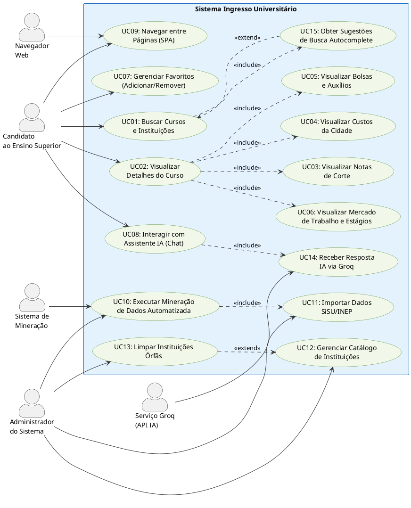
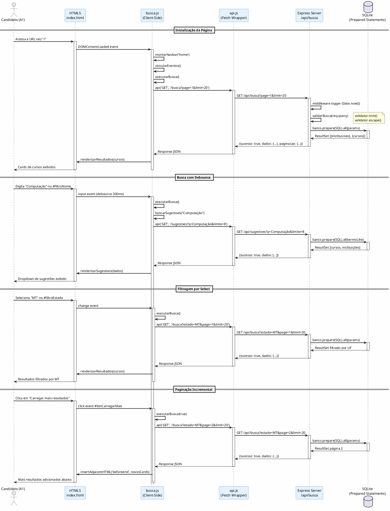
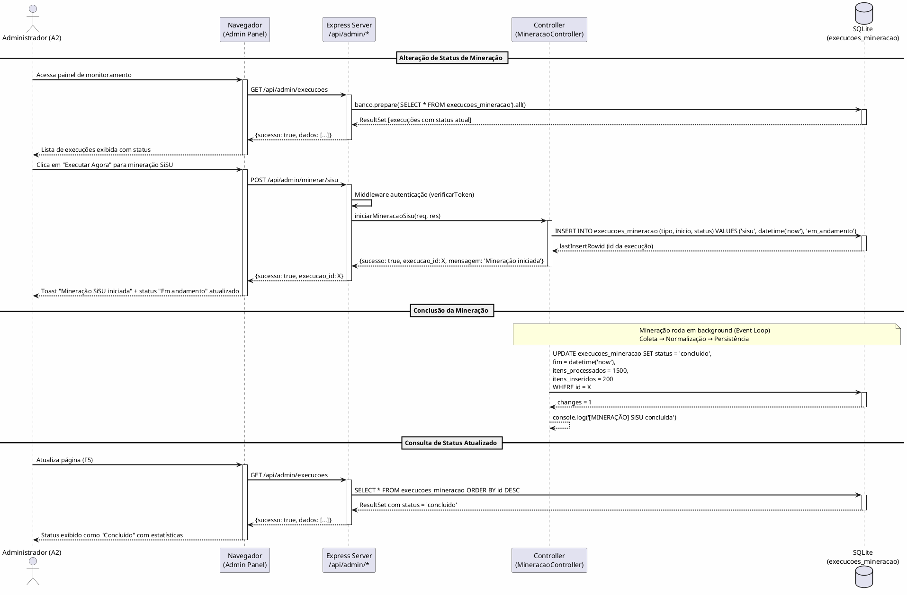

# Requisitos de Usuário — Sistema Ingresso Universitário

**Versão do Documento:** 1.0  
**Data:** 08 de setembro de 2026  
**Padrões de Referência:** OMG UML 2.5.1 · ISO/IEC/IEEE 29148:2018 · FURPS+ / ISO/IEC 25010  
**Classificação:** Documento de Requisitos de Usuário (URD — User Requirements Document)

---

## Sumário

1. [Identificação e Caracterização Formal dos Atores do Sistema](#1-identificação-e-caracterização-formal-dos-atores-do-sistema)
2. [Diagrama de Casos de Uso](#2-diagrama-de-casos-de-uso)
3. [Catálogo Detalhado de Requisitos de Usuário (RU)](#3-catálogo-detalhado-de-requisitos-de-usuário-ru)
4. [Histórias de Usuário e Critérios de Aceite BDD/Gherkin](#4-histórias-de-usuário-e-critérios-de-aceite-bddgherkin)
5. [Diagramas de Sequência de Usuário](#5-diagramas-de-sequência-de-usuário)

---

## 1. Identificação e Caracterização Formal dos Atores do Sistema

### 1.1 Definição Conceitual (conforme UML 2.5.1, §12.2)

Um **Ator** (Actor) modela uma entidade que interage com o Sistema, desempenhando um papel (role) específico. Atores não são partes internas do sistema; são externos e iniciam ou recebem comunicação com o sistema. Conforme a especificação UML 2.5.1, um ator pertence a um Package e pode ser especializado via herança.

### 1.2 Taxonomia dos Atores

| ID | Ator | Estereótipo | Descrição |
|----|------|-------------|-----------|
| **A1** | **Candidato ao Ensino Superior** | `<<actor primário>>` | Pessoa física (estudante, egresso ou profissional) que busca informações sobre cursos, universidades, notas de corte, custos de moradia, bolsas e mercado de trabalho para tomada de decisão regarding ingresso universitário. É o ator primário que inicia a maioria dos fluxos de uso do sistema. |
| **A2** | **Administrador do Sistema** | `<<actor secundário>>` | Profissional responsável pela gestão operacional do catálogo de dados, execução de rotinas de mineração (web scraping), importação de dados abertos e manutenção do banco de dados. Possui acesso privilegiado a rotas administrativas protegidas. |
| **A3** | **Sistema de Mineração (Agendador)** | `<<actor sistêmico>>` | Componente de software interno (node-cron) que dispara coletas periódicas de dados de fontes externas (catálogo INEP, SiSU/MEC, custo de vida, mercado de trabalho) de forma autônoma, sem intervenção humana direta. Executa sob controle do Event Loop do Node.js. |
| **A4** | **Serviço Externo Groq (API de IA)** | `<<actor sistêmico>>` | Serviço em nuvem de processamento de linguagem natural (LLM) que processa mensagens do chat assistente e retorna respostas geradas. Comunicação via protocolo HTTPS/REST com autenticação por API Key. |
| **A5** | **Navegador Web (Cliente HTTP)** | `<<actor sistêmico>>` | Agente de usuário automatizado (browser) que renderiza a interface HTML5/CSS3/JavaScript, envia requisições fetch à API REST e gerencia o armazenamento local (localStorage) para sessão e favoritos do usuário. |

### 1.3 Diagrama de Especialização de Atores (Herança UML)

```
          ┌──────────────────────────┐
          │      «actor»             │
          │    CANDIDATO (A1)        │
          │   <<actor primário>>     │
          └────────────┬─────────────┘
                       │
          ┌────────────┴─────────────┐
          │      «actor»             │
          │  ADMINISTRADOR (A2)      │
          │  <<actor secundário>>    │
          └────────────┬─────────────┘
                       │
          ┌────────────┴─────────────┐
          │      «actor»             │
          │  SISTEMA MINERAÇÃO (A3)  │
          │  <<actor sistêmico>>     │
          └──────────────────────────┘
```

### 1.4 Matriz de Atributos dos Atores

| Atores | Autenticação | Nível de Experiência | Frequência de Uso | Dispositivo |
|--------|-------------|---------------------|-------------------|-------------|
| A1 — Candidato | Não requer (anônimo via sessão UUID) | Intermediário (estudante) | Diária / Saazonal (período de inscrição SiSU) | Desktop, Tablet, Mobile |
| A2 — Administrador | Requer (chave de acesso / credenciais) | Avançado (técnico) | Semanal / Conforme necessidade | Desktop |
| A3 — Sistema Mineração | Interno (agendador cron) | Automatizado | Programada (cron expressions) | Servidor (headless) |
| A4 — Serviço Groq | API Key no cabeçalho Authorization | N/A (serviço externo) | Sob demanda (chat) | Servidor (HTTPS) |
| A5 — Navegador Web | N/A (renderização) | N/A (agente) | Contínuo durante sessão | Qualquer |

---

## 2. Diagrama de Casos de Uso

### 2.1 Definição do System Boundary

O **System Boundary** (Fronteira do Sistema) delimita o escopo funcional do **Sistema Ingresso Universitário**. Tudo dentro do retângulo pertence ao sistema; tudo fora são atores ou subsistemas externos.

### 2.2 Diagrama de Casos de Uso em PlantUML



### 2.3 Especificação dos Casos de Uso

#### UC01: Buscar Cursos e Instituições

| Elemento | Descrição |
|----------|-----------|
| **ID** | UC01 |
| **Nome** | Buscar Cursos e Instituições |
| **Atores Primários** | A1 (Candidato) |
| **Atores Secundários** | A5 (Navegador Web) |
| **Pré-condições** | O sistema está operacional; o banco de dados contém registros de cursos e instituições. |
| **Pós-condições** | Lista paginada de cursos/instituições correspondentes aos filtros é exibida ao usuário. |
| **Fluxo Principal** | 1. O Candidato acessa a página inicial. 2. Preenche campos de filtro (nome, UF, categoria). 3. Clica em "Buscar" ou aguarda debounce automático. 4. O sistema consulta a API REST. 5. Os resultados são renderizados em cards com paginação incremental. |
| **Fluxos Alternativos** | 5a. Se nenhum resultado encontrado → exibe estado vazio. 5b. Se erro de conexão → exibe mensagem de erro. |
| **Inclusões** | <<include>> UC15 (Obter Sugestões de Busca Autocomplete) |

#### UC02: Visualizar Detalhes do Curso

| Elemento | Descrição |
|----------|-----------|
| **ID** | UC02 |
| **Nome** | Visualizar Detalhes do Curso |
| **Atores Primários** | A1 (Candidato) |
| **Pré-condições** | O curso existe no banco de dados e está ativo (ativo = 1). |
| **Pós-condições** | Página de detalhes com todas as abas (notas, custos, bolsas, mercado, outros cursos da instituição) é exibida. |
| **Fluxo Principal** | 1. O Candidato clica em um card de resultado. 2. O sistema navega para detalhes.html com o ID do curso. 3. Exibe skeleton durante carregamento. 4. Busca dados completos via API. 5. Renderiza cabeçalho e abas de informações. |
| **Inclusões** | <<include>> UC03, <<include>> UC04, <<include>> UC05, <<include>> UC06 |

#### UC03: Visualizar Notas de Corte

| Elemento | Descrição |
|----------|-----------|
| **ID** | UC03 |
| **Nome** | Visualizar Notas de Corte |
| **Atores Primários** | A1 (Candidato) |
| **Pré-condições** | O curso possui registros na tabela notas_corte. |
| **Pós-condições** | Tabela com notas de corte por processo seletivo (SiSU), ano e chamada é exibida. |
| **Fluxo Principal** | 1. O Candidato seleciona a aba "Notas de corte". 2. O sistema consulta a API /api/cursos/:id/notas-corte. 3. Renderiza tabela com processo, ano, chamada, nota de corte e fonte. |

#### UC04: Visualizar Custos da Cidade

| Elemento | Descrição |
|----------|-----------|
| **ID** | UC04 |
| **Nome** | Visualizar Custos da Cidade |
| **Atores Primários** | A1 (Candidato) |
| **Pré-condições** | A cidade do curso possui registros na tabela custos_cidade. |
| **Pós-condições** | Cards com custos de moradia, alimentação, transporte, outros e total são exibidos. |
| **Fluxo Principal** | 1. O Candidato seleciona a aba "Custos da cidade". 2. O sistema consulta a API /api/cidades/:cidade/custos. 3. Renderiza cards com ícones e valores formatados em R$. |

#### UC05: Visualizar Bolsas e Auxílios

| Elemento | Descrição |
|----------|-----------|
| **ID** | UC05 |
| **Nome** | Visualizar Bolsas e Auxílios |
| **Atores Primários** | A1 (Candidato) |
| **Pré-condições** | A instituição do curso possui registros na tabela auxilios_bolsas. |
| **Pós-condições** | Lista de bolsas e auxílios com descrição, tipo e links externos é exibida. |
| **Fluxo Principal** | 1. O Candidato seleciona a aba "Bolsas e auxílios". 2. O sistema consulta a API /api/cursos/:id/auxilios-bolsas. 3. Renderiza lista com badges de tipo (bolsa/auxílio). |

#### UC06: Visualizar Mercado de Trabalho e Estágios

| Elemento | Descrição |
|----------|-----------|
| **ID** | UC06 |
| **Nome** | Visualizar Mercado de Trabalho e Estágios |
| **Atores Primários** | A1 (Candidato) |
| **Pré-condições** | O curso possui registros na tabela mercado_estagios. |
| **Pós-condições** | Dados de demanda, salário médio e vagas de estágio são exibidos. |
| **Fluxo Principal** | 1. O Candidato seleciona a aba "Mercado e estágios". 2. O sistema consulta a API /api/cursos/:id/mercado-estagios. 3. Renderiza cards com badges de demanda (alta/média/baixa). |

#### UC07: Gerenciar Favoritos (Adicionar/Remover)

| Elemento | Descrição |
|----------|-----------|
| **ID** | UC07 |
| **Nome** | Gerenciar Favoritos |
| **Atores Primários** | A1 (Candidato) |
| **Atores Secundários** | A5 (Navegador — localStorage) |
| **Pré-condições** | O Candidato está navegando no sistema. Uma sessão UUID existe ou será criada. |
| **Pós-condições** | O curso está adicionado/removido da lista de favoritos (local + API). |
| **Fluxo Principal** | 1. O Candidato clica no botão estrela de favorito. 2. O sistema verifica se já está favoritado. 3a. Se não: adiciona ao localStorage e sincroniza com API (POST /api/favoritos). 3b. Se sim: remove do localStorage e sincroniza com API (DELETE /api/favoritos/:id). 4. Exibe toast de confirmação. |
| **Fluxos Alternativos** | 3a. Se duplicata na API → retorna 409 e mantém estado local. |

#### UC08: Interagir com Assistente IA (Chat)

| Elemento | Descrição |
|----------|-----------|
| **ID** | UC08 |
| **Nome** | Interagir com Assistente IA |
| **Atores Primários** | A1 (Candidato) |
| **Atores Secundários** | A4 (Serviço Groq) |
| **Pré-condições** | A API Groq está configurada (variável de ambiente chave_groq). |
| **Pós-condições** | Resposta gerada pela IA é exibida na janela de chat. |
| **Fluxo Principal** | 1. O Candidato abre o painel de chat. 2. Digita mensagem e envia. 3. O sistema exibe indicador de digitação. 4. Envia POST /api/groq-chat. 5. O serviço Groq processa e retorna resposta. 6. A resposta é renderizada no chat. |
| **Inclusões** | <<include>> UC14 (Receber Resposta IA via Groq) |

#### UC09: Navegar entre Páginas (SPA)

| Elemento | Descrição |
|----------|-----------|
| **ID** | UC09 |
| **Nome** | Navegar entre Páginas |
| **Atores Primários** | A1 (Candidato), A5 (Navegador) |
| **Pré-condições** | O servidor Express está servindo os arquivos estáticos do frontend. |
| **Pós-condições** | A página solicitada é renderizada com navegação client-side. |
| **Fluxo Principal** | 1. O Candidato clica em link de navegação (navbar). 2. O Navegador carrega a nova página HTML. 3. Os scripts JS inicializam a página. 4. O fallback SPA redireciona rotas não-API para index.html. |

#### UC10: Executar Mineração de Dados Automatizada

| Elemento | Descrição |
|----------|-----------|
| **ID** | UC10 |
| **Nome** | Executar Mineração de Dados Automatizada |
| **Atores Primários** | A3 (Sistema Mineração) |
| **Atores Secundários** | A2 (Administrador — configuração) |
| **Pré-condições** | MINERACAO_ENABLED=true; agendador cron inicializado. |
| **Pós-condições** | Dados de fontes externas são coletados, normalizados e persistidos no banco. |
| **Fluxo Principal** | 1. O agendador dispara tarefa conforme cron expression. 2. O coletor realiza HTTP requests para fontes externas. 3. Os dados são parseados (cheerio/JSON). 4. Os dados são normalizados. 5. Os dados são persistidos via Prepared Statements. 6. Log de execução é registrado. |
| **Inclusões** | <<include>> UC11 (Importar Dados SiSU/INEP) |

#### UC11: Importar Dados SiSU/INEP

| Elemento | Descrição |
|----------|-----------|
| **ID** | UC11 |
| **Nome** | Importar Dados SiSU/INEP |
| **Atores Primários** | A3 (Sistema Mineração), A2 (Administrador via CLI) |
| **Pré-condições** | Fontes de dados SiSU/INEP estão acessíveis via HTTP. |
| **Pós-condições** | Tabelas de cursos, notas de corte e instituições são atualizadas com dados novos. |
| **Fluxo Principal** | 1. Coleta dados de SISSU/MEC. 2. Normaliza e deduplica registros. 3. Executa INSERT OR UPDATE no banco. 4. Registra estatísticas na tabela execucoes_mineracao. |

#### UC12: Gerenciar Catálogo de Instituições

| Elemento | Descrição |
|----------|-----------|
| **ID** | UC12 |
| **Nome** | Gerenciar Catálogo de Instituições |
| **Atores Primários** | A2 (Administrador) |
| **Pré-condições** | O administrador possui acesso ao servidor e às rotas CLI. |
| **Pós-condições** | O catálogo de instituições é atualizado com novas entradas ou correções. |
| **Fluxo Principal** | 1. O Administrador executa script CLI. 2. O sistema coleta/inseri/atualiza registros de instituições. 3. Log de execução é registrado. |

#### UC13: Limpar Instituições Órfãs

| Elemento | Descrição |
|----------|-----------|
| **ID** | UC13 |
| **Nome** | Limpar Instituições Órfãs |
| **Atores Primários** | A2 (Administrador) |
| **Pré-condições** | Existem instituições sem cursos associados. |
| **Pós-condições** | Instituições sem vínculo com cursos são marcadas como inativas (ativo = 0). |
| **Fluxo Principal** | 1. O Administrador executa o script limparInstituicoesOrfas.js. 2. O sistema identifica instituições órfãs. 3. Atualiza campo ativo para 0. |
| **Extensões** | <<extend>> UC12 (operação de manutenção do catálogo) |

#### UC14: Receber Resposta IA via Groq

| Elemento | Descrição |
|----------|-----------|
| **ID** | UC14 |
| **Nome** | Receber Resposta IA via Groq |
| **Atores Primários** | A4 (Serviço Groq) |
| **Pré-condições** | A chave de API Groq está configurada. O modelo LLM está disponível. |
| **Pós-condições** | Resposta gerada é retornada ao backend e encaminhada ao frontend. |
| **Fluxo Principal** | 1. O backend envia POST para api.groq.com. 2. O serviço processa com modelo qwen ou allam. 3. Retorna content ou reasoning_content. 4. O backend repass ao frontend. |
| **Extensões** | <<extend>> UC08 (o chat do usuário dispara esta interação) |

#### UC15: Obter Sugestões de Busca Autocomplete

| Elemento | Descrição |
|----------|-----------|
| **ID** | UC15 |
| **Nome** | Obter Sugestões de Busca Autocomplete |
| **Atores Primários** | A1 (Candidato) |
| **Pré-condições** | O termo de busca possui pelo menos 2 caracteres. |
| **Pós-condições** | Lista de sugestões (cursos e instituições) é exibida em dropdown. |
| **Fluxo Principal** | 1. O Candidato digita no campo de busca. 2. Após debounce (300ms), o sistema consulta /api/sugestoes?q=...&limite=8. 3. Renderiza dropdown com sugestões categorizadas (curso/instituição). |
| **Extensões** | <<extend>> UC01 (funcionalidade de autocomplete integrada à busca) |

---

## 3. Catálogo Detalhado de Requisitos de Usuário (RU)

### RU01: Busca de Cursos e Instituições com Filtros

| Campo | Valor |
|-------|-------|
| **ID** | RU01 |
| **Caso de Uso** | UC01 |
| **Ator Principal** | A1 — Candidato |
| **Prioridade (MoSCoW)** | **Must Have** |
| **Pré-condições** | 1. O navegador está conectado ao servidor. 2. A página inicial (index.html) foi carregada. 3. O banco de dados contém registros de cursos e instituições. |
| **Fluxo Operacional** | 1. O Candidato acessa a URL raiz do sistema (/). 2. O navegador renderiza a seção Hero com os 4 pilares do sistema. 3. O Candidato localiza o formulário "Filtros de busca". 4. O Candidato preenche o campo "Curso ou instituição" (filtroNome) com termo de busca (ex.: "Computação"). 5. O sistema (via JavaScript debounce de 300ms) envia requisição GET para /api/busca?q={termo}&page=1&limit=20. 6. O backend valida e sanitiza os parâmetros usando validator (trim + escape). 7. O backend executa Prepared Statements no SQLite com filtros parametrizados (nome LIKE ?, estado = ?, categoria = ?). 8. O backend retorna JSON com {sucesso: true, dados: {instituicoes: [...], cursos: [...]}, paginacao: {...}}. 9. O frontend renderiza cards de resultado usando a função cardResultado(). 10. O Candidato pode filtrar por Estado (UF) usando <select> ou por Categoria (federal/estadual/municipal). 11. O resultado é atualizado a cada mudança de filtro. 12. O botão "Carregar mais resultados" habilita paginação incremental. |
| **Pós-condições** | 1. Lista de cursos/instituições é exibida em cards responsivos. 2. O contador de resultados é atualizado. 3. O cache de sugestões é populado. |

### RU02: Visualização de Detalhes do Curso com Abas

| Campo | Valor |
|-------|-------|
| **ID** | RU02 |
| **Caso de Uso** | UC02 |
| **Ator Principal** | A1 — Candidato |
| **Prioridade (MoSCoW)** | **Must Have** |
| **Pré-condições** | 1. O curso existe no banco (ativo = 1). 2. O parâmetro ?id={cursoId} está na URL. |
| **Fluxo Operacional** | 1. O Candidato clica em um card de resultado na busca. 2. O navegador navega para /paginas/detalhes.html?id={id}. 3. O frontend exibe skeleton de carregamento (div#detalheSkeleton). 4. O frontend envia GET para /api/cursos/{id}. 5. O backend executa JOIN de cursos, instituições e campi via Prepared Statement. 6. O backend busca notas de corte, custos, auxílios e mercado em paralelo (sequencial no SQLite síncrono). 7. O frontend renderiza cabeçalho do curso com badges de categoria, grau, modalidade, turno. 8. O frontend renderiza 5 abas navegáveis: Notas de corte, Custos da cidade, Bolsas e auxílios, Mercado e estágios, Cursos da instituição. 9. O Candidato navega entre as abas usando role="tablist" com navegação por teclado (ArrowLeft/ArrowRight). |
| **Pós-condições** | 1. Todos os dados detalhados do curso estão visíveis. 2. O botão de favorito está disponível. |

### RU03: Exibição de Notas de Corte por Processo Seletivo

| Campo | Valor |
|-------|-------|
| **ID** | RU03 |
| **Caso de Uso** | UC03 |
| **Ator Principal** | A1 — Candidato |
| **Prioridade (MoSCoW)** | **Must Have** |
| **Pré-condições** | 1. O curso possui registros na tabela notas_corte. 2. O Candidato está na aba "Notas de corte". |
| **Fluxo Operacional** | 1. O frontend envia GET para /api/cursos/{id}/notas-corte. 2. O backend busca registros via notaCorteModelo.buscarPorCurso(id). 3. O backend retorna JSON com array de notas incluindo processo, ano, chamada, nota_corte, fonte_tipo. 4. O frontend renderiza tabela HTML com colunas: Processo, Ano, Chamada, Nota de Corte, Fonte. 5. Cada linha exibe badge colorido (azul para SiSU, roxo para ProUni). 6. A coluna Fonte indica se é "Fonte oficial" ou "Dados abertos". 7. Se não houver notas → exibe estado vazio "Nenhuma nota de corte registrada para este curso." |
| **Pós-condições** | 1. Tabela de notas de corte é exibida com todos os registros disponíveis. |

### RU04: Exibição de Custos de Moradia por Cidade

| Campo | Valor |
|-------|-------|
| **ID** | RU04 |
| **Caso de Uso** | UC04 |
| **Ator Principal** | A1 — Candidato |
| **Prioridade (MoSCoW)** | **Must Have** |
| **Pré-condições** | 1. A cidade do curso possui registros na tabela custos_cidade. 2. O Candidato está na aba "Custos da cidade". |
| **Fluxo Operacional** | 1. O frontend identifica a cidade do curso (curso.cidade). 2. O frontend envia GET para /api/cidades/{cidade}/custos. 3. O backend busca registros via custoCidadeModelo.buscarPorCidade(). 4. O backend retorna JSON com moradia, alimentação, transporte, outros, custo_total. 5. O frontend renderiza cards com ícones SVG (casa, comida, ônibus, cartão) e valores formatados em R$ (formatarMoeda()). 6. O card de custo total é destacado com ring indigo. |
| **Pós-condições** | 1. Custos detalhados da cidade são exibidos. |

### RU05: Exibição de Bolsas e Auxílios da Instituição

| Campo | Valor |
|-------|-------|
| **ID** | RU05 |
| **Caso de Uso** | UC05 |
| **Ator Principal** | A1 — Candidato |
| **Prioridade (MoSCoW)** | **Must Have** |
| **Pré-condições** | 1. A instituição do curso possui registros na tabela auxilios_bolsas. 2. O Candidato está na aba "Bolsas e auxílios". |
| **Fluxo Operacional** | 1. O frontend envia GET para /api/cursos/{id}/auxilios-bolsas. 2. O backend resolve o instituicao_id a partir do curso_id. 3. O backend busca auxílios via auxilioBolsaModelo.buscarPorInstituicao(). 4. O backend retorna JSON com nome, tipo, descricao, publico_alvo, url. 5. O frontend renderiza lista com cards de cada auxílio/bolsa. 6. Badges de tipo: verde para "bolsa", amarelo para "auxílio". 7. Links externos são abertos em nova aba com rel="noopener". |
| **Pós-condições** | 1. Lista de bolsas e auxílios é exibida com links de referência. |

### RU06: Exibição de Dados de Mercado de Trabalho

| Campo | Valor |
|-------|-------|
| **ID** | RU06 |
| **Caso de Uso** | UC06 |
| **Ator Principal** | A1 — Candidato |
| **Prioridade (MoSCoW)** | **Should Have** |
| **Pré-condições** | 1. O curso possui registros na tabela mercado_estagios. 2. O Candidato está na aba "Mercado e estágios". |
| **Fluxo Operacional** | 1. O frontend envia GET para /api/cursos/{id}/mercado-estagios. 2. O backend busca registros via mercadoEstagioModelo.buscarPorCurso(). 3. O backend retorna JSON com regiao, demanda, salario_medio, vagas_estagio, fonte. 4. O frontend renderiza cards com badges de demanda (verde=alta, amarelo=média, vermelho=baixa). 5. Salário médio é formatado em R$. |
| **Pós-condições** | 1. Indicadores de mercado e estágios são exibidos. |

### RU07: Gerenciamento de Favoritos (Adicionar/Remover)

| Campo | Valor |
|-------|-------|
| **ID** | RU07 |
| **Caso de Uso** | UC07 |
| **Ator Principal** | A1 — Candidato |
| **Prioridade (MoSCoW)** | **Must Have** |
| **Pré-condições** | 1. O Candidato está visualizando um card ou detalhe de curso. 2. Uma sessão UUID existe ou será gerada automaticamente no localStorage. |
| **Fluxo Operacional** | 1. O Candidato clica no botão estrela (data-favoritar="{id}"). 2. O JavaScript verifica se o curso já está na lista local (estaFavoritado()). 3a. **Adicionar:** 3a.1. Cria objeto favoritoLocal com curso_id, nome, instituição, etc. 3a.2. Adiciona ao array no localStorage. 3a.3. Salva no localStorage. 3a.4. Atualiza visual do botão (fill da estrela + cor amber). 3a.5. Exibe toast "{nome} adicionado aos favoritos." 3a.6. Envia POST /api/favoritos com {sessao_usuario, curso_id, instituicao_id}. 3a.7. Atualiza o ID local com o ID retornado pela API. 3b. **Remover:** 3b.1. Remove do array no localStorage. 3b.2. Atualiza visual do botão. 3b.3. Exibe toast "{nome} removido dos favoritos." 3b.4. Envia DELETE /api/favoritos/{id}?sessao_usuario={sessao}. |
| **Pós-condições** | 1. O estado de favorito está sincronizado entre localStorage e API. 2. O contador de favoritos na navbar é atualizado. |

### RU08: Interação com Assistente IA via Chat

| Campo | Valor |
|-------|-------|
| **ID** | RU08 |
| **Caso de Uso** | UC08 |
| **Ator Principal** | A1 — Candidato |
| **Prioridade (MoSCoW)** | **Could Have** |
| **Pré-condições** | 1. A chave de API Groq está configurada no servidor. 2. O Candidato clica no botão flutuante de chat. |
| **Fluxo Operacional** | 1. O Candidato clica no botão flutuante (#btn-abrir-chat). 2. O painel de chat (#painel-chat) é exibido com transição CSS. 3. O campo de input é focado automaticamente. 4. O Candidato digita uma mensagem (máx. 500 caracteres). 5. O Candidato clica em "Enviar" ou pressiona Enter. 6. A mensagem do usuário é adicionada à área de mensagens com alinhamento à direita (bg-indigo-600). 7. O indicador "Bot está digitando..." é exibido. 8. O frontend envia POST /api/groq-chat com {mensagem: "..."}. 9. O backend envia para a API Groq com modelo qwen3.8-27b (fallback: qwen3.6-27b, allam-2-7b). 10. A resposta da IA é exibida com alinhamento à esquerda (bg-gray-200). 11. O contador de mensagens é atualizado. 12. As mensagens são persistidas no localStorage para preservação entre sessões. |
| **Pós-condições** | 1. Mensagens da conversa são exibidas e persistidas localmente. 2. O painel pode ser fechado mantendo o histórico. |

### RU09: Navegação entre Páginas do Sistema

| Campo | Valor |
|-------|-------|
| **ID** | RU09 |
| **Caso de Uso** | UC09 |
| **Ator Principal** | A1 — Candidato |
| **Prioridade (MoSCoW)** | **Must Have** |
| **Pré-condições** | 1. O navegador carregou qualquer página do sistema. |
| **Fluxo Operacional** | 1. O navbar é renderizado dinamicamente via montarNavbar(). 2. Os links de navegação são: "Busca" (index.html), "Favoritos" (favoritos.html). 3. O link ativo é destacado com borda indigo e fonte bold. 4. O contador de favoritos é exibido como badge no link "Favoritos". 5. A função caminhoBase() ajusta os caminhos relativos conforme a página atual (raiz ou /paginas/). |
| **Pós-condições** | 1. Navegação fluida entre páginas. 2. Estado de favoritos é preservado. |

### RU10: Autocomplete de Sugestões de Busca

| Campo | Valor |
|-------|-------|
| **ID** | RU10 |
| **Caso de Uso** | UC15 |
| **Ator Principal** | A1 — Candidato |
| **Prioridade (MoSCoW)** | **Should Have** |
| **Pré-condições** | 1. O campo de busca possui pelo menos 2 caracteres. |
| **Fluxo Operacional** | 1. O Candidato digita no campo #filtroNome. 2. Após debounce de 300ms, o sistema consulta /api/sugestoes?q={termo}&limite=8. 3. O backend busca cursos e instituições com LIKE. 4. Retorna array de objetos {id, texto, subtitulo, tipo}. 5. O frontend renderiza dropdown (#areaSugestoes) com itens categorizados (curso/instituição). 6. Navegação por teclado: ArrowDown/ArrowUp/Enter/Escape. 7. Ao clicar em sugestão, navega para detalhes.html?id={id}. |
| **Pós-condições** | 1. Sugestões relevantes são exibidas em tempo real. |

---

## 4. Histórias de Usuário e Critérios de Aceite BDD/Gherkin

### HU01: Busca de Cursos

**Como** Candidato ao Ensino Superior,  
**Eu quero** buscar cursos e instituições por nome, estado e categoria,  
**Para que** eu possa encontrar opções de graduação relevantes para minha decisão de ingresso.

**Critérios de Aceite (Gherkin):**

```gherkin
Cenário: Busca bem-sucedida por curso
  Dado que o Candidato está na página inicial do sistema
  E o banco de dados contém o curso "Ciência da Computação" na UFMT
  Quando o Candidato digita "Computação" no campo de busca
  E aguarda 300 milissegundos (debounce)
  Então o sistema exibe cards com cursos que contêm "Computação" no nome
  E o contador de resultados é atualizado

Cenário: Busca sem resultados
  Dado que o Candidato está na página inicial
  Quando o Candidato digista "XYZABC123" no campo de busca
  Então o sistema exibe a mensagem "Nenhum curso encontrado com os filtros selecionados."

Cenário: Filtrar por estado
  Dado que o Candidato está na página inicial
  Quando o Candidato seleciona "MT - Mato Grosso" no filtro de estado
  Então o sistema exibe apenas cursos cujo estado é "MT"

Cenário: Filtrar por categoria
  Dado que o Candidato está na página inicial
  Quando o Candidato seleciona "Federal" no filtro de categoria
  Then o sistema exibe apenas instituições com categoria_administrativa = "federal"
```

### HU02: Visualização de Detalhes do Curso

**Como** Candidato ao Ensino Superior,  
**Eu quero** visualizar detalhes completos de um curso incluindo notas de corte, custos, bolsas e mercado,  
**Para que** eu possa tomar uma decisão informada sobre meu ingresso.

**Critérios de Aceite (Gherkin):**

```gherkin
Cenário: Acesso aos detalhes de um curso
  Dado que o Candidato está na página de busca com resultados
  Quando o Candidato clica no card do curso "Ciência da Computação"
  Então o navegador navega para detalhes.html?id=1
  E um skeleton de carregamento é exibido
  E os dados do curso são carregados via API
  E o cabeçalho do curso exibe nome, instituição, grau, modalidade

Cenário: Navegação entre abas
  Dado que o Candidato está na página de detalhes do curso
  Quando o Candidato clica na aba "Custos da cidade"
  Então a aba "Custos da cidade" fica ativa (aria-selected="true")
  E a aba "Notas de corte" fica oculta
  E os custos da cidade são exibidos

Cenário: Exibição de notas de corte
  Dado que o curso possui notas de corte registradas
  Quando o Candidato acessa a aba "Notas de corte"
  Então uma tabela é exibida com colunas: Processo, Ano, Chamada, Nota de Corte, Fonte
```

### HU03: Gerenciamento de Favoritos

**Como** Candidato ao Ensino Superior,  
**Eu quero** favoritar cursos de interesse para acesso rápido posterior,  
**Para que** eu possa comparar opções ao longo do tempo.

**Critérios de Aceite (Gherkin):**

```gherkin
Cenário: Adicionar curso aos favoritos
  Dado que o Candidato está visualizando um card de curso não favoritado
  Quando o Candidato clica no botão estrela
  Então o botão muda para cor amber com texto "Favoritado"
  E um toast é exibido com "{nome} adicionado aos favoritos."
  E o curso é salvo no localStorage
  E o curso é enviado para a API via POST /api/favoritos
  E o contador de favoritos na navbar é incrementado

Cenário: Remover curso dos favoritos
  Dado que o Candidato está visualizando um card de curso favoritado
  Quando o Candidato clica no botão estrela
  Então o botão muda para cor branca com texto "Favoritar"
  E um toast é exibido com "{nome} removido dos favoritos."
  E o curso é removido do localStorage
  E o curso é removido da API via DELETE /api/favoritos/{id}

Cenário: Página de favoritos vazia
  Dado que o Candidato não possui nenhum curso favoritado
  Quando o Candidato acessa a página de favoritos
  Então a mensagem "Você ainda não favoritou nenhum curso." é exibida

Cenário: Sessão de favoritos persistente
  Dado que o Candidato adicionou um curso aos favoritos
  Quando o Candidato fecha e reabre o navegador
  E acessa a página de favoritos
  Então o curso favoritado anteriormente仍 é exibido
```

### HU04: Interação com Assistente IA

**Como** Candidato ao Ensino Superior,  
**Eu quero** conversar com um assistente IA para tirar dúvidas sobre cursos e universidades,  
**Para que** eu obtenha respostas rápidas e personalizadas.

**Critérios de Aceite (Gherkin):**

```gherkin
Cenário: Enviar mensagem e receber resposta
  Dado que o Candidato abriu o painel de chat
  Quando o Candidato digita "Quais são as melhores universidades de Mato Grosso?"
  E clica em "Enviar"
  Então a mensagem do usuário aparece na área de mensagens com cor indigo
  E o indicador "Bot está digitando..." é exibido
  E uma resposta da IA é exibida com cor cinza
  E a resposta contém informações sobre universidades

Cenário: Mensagem vazia
  Dado que o Candidato está no painel de chat
  Quando o Candidato clica em "Enviar" sem digitar nada
  Então nenhuma mensagem é enviada

Cenário: Erro de conexão
  Dado que o servidor está offline
  Quando o Candidato envia uma mensagem
  Então a mensagem "Sem conexão com a API. Verifique se o servidor está rodando." é exibida

Cenário: Persistência de mensagens
  Dado que o Candidato enviou mensagens anteriormente
  Quando o Candidato reabre o painel de chat
  Então as mensagens anteriores仍 são exibidas (carregadas do localStorage)
```

### HU05: Exibição de Custos de Moradia

**Como** Candidato ao Ensino Superior,  
**Eu quero** visualizar os custos estimados de moradia, alimentação e transporte da cidade do curso,  
**Para que** eu possa planejar financeiramente meu deslocamento para a universidade.

**Critérios de Aceite (Gherkin):**

```gherkin
Cenário: Custos disponíveis para a cidade
  Dado que o curso está localizado em "Cuiabá"
  E existem registros de custos para "Cuiabá"
  Quando o Candidato acessa a aba "Custos da cidade"
  Então cards com moradia, alimentação, transporte, outros e custo total são exibidos
  E os valores estão formatados em R$ (formato brasileiro)

Cenário: Custos não disponíveis
  Dado que o curso está localizado em uma cidade sem registros de custos
  Quando o Candidato acessa a aba "Custos da cidade"
  Então a mensagem "Nenhum custo disponível para esta cidade." é exibida
```

---

## 5. Diagramas de Sequência de Usuário

### DS01: Formulário de Busca Pública com Validação Client-Side



### DS02: Fluxo de Login Administrativo com Sessão/Token

> **Nota:** O sistema atual não implementa autenticação JWT/cookie. Este DS descreve o fluxo conforme a especificação de segurança descrita no documento de Requisitos de Sistema, representando o estado desejado (to-be) para acesso administrativo.

```plantuml
@startuml
skinparam backgroundColor #FEFEFE
skinparam sequenceArrowThickness 2

actor "Administrador (A2)" as Admin
participant "Navegador\n(login.html)" as HTML
participant "Express Server\n(Middleware Auth)" as Auth
participant "Controller\n/AdminController" as Ctrl
database "SQLite\n(usuarios table)" as DB
participant "jwt.sign()\n(Token Generation)" as JWT

== Autenticação do Administrador ==

Admin -> HTML : Acessa /admin/login
activate HTML
HTML --> Admin : Formulário de login exibido
deactivate HTML

Admin -> HTML : Preenche email + senha e clica "Entrar"
activate HTML
HTML -> Auth : POST /api/admin/login {email, senha}
activate Auth
Auth -> Auth : Middleware sanitização (express-validator)
Auth -> DB : banco.prepare('SELECT * FROM usuarios WHERE email = ?').get(email)
activate DB
DB --> Auth : ResultSet {id, email, senha_hash, role}
deactivate DB

Auth -> Auth : bcrypt.compare(senha, senha_hash)
note right : Verificação assíncrona\ncom salt aleatório

alt Credenciais válidas
  Auth -> JWT : jwt.sign({id, role: 'admin'}, SECRET, {expiresIn: '8h'})
  JWT --> Auth : token JWT
  Auth --> HTML : {sucesso: true, token, redirect: '/admin/dashboard'}
  deactivate Auth
  HTML -> HTML : localStorage.setItem('admin_token', token)
  HTML -> HTML : window.location.href = '/admin/dashboard'
  HTML --> Admin : Painel administrativo exibido
else Credenciais inválidas
  Auth --> HTML : {sucesso: false, mensagem: 'Credenciais inválidas'}
  deactivate Auth
  HTML --> Admin : Toast de erro exibido
endif
deactivate HTML

== Requisições Administrativas Protegidas ==

Admin -> HTML : Acessa rota administrativa
activate HTML
HTML -> Auth : GET /api/admin/dados\nHeaders: Authorization: Bearer {token}
activate Auth
Auth -> Auth : Middleware verificarToken()
Auth -> Auth : jwt.verify(token, SECRET)

alt Token válido
  Auth -> Ctrl : handler(req, res)
  activate Ctrl
  Ctrl -> DB : Prepared Statement query
  activate DB
  DB --> Ctrl : ResultSet
  deactivate DB
  Ctrl --> Auth : {sucesso: true, dados: {...}}
  deactivate Ctrl
  Auth --> HTML : Response JSON
  deactivate Auth
  HTML --> Admin : Dados exibidos
else Token expirado/inválido
  Auth --> HTML : {sucesso: false, mensagem: 'Token inválido'}
  deactivate Auth
  HTML -> HTML : localStorage.removeItem('admin_token')
  HTML --> Admin : Redirecionamento para /admin/login
endif
deactivate HTML

@enduml
```

### DS03: Alteração Operacional de Status de Atendimento

> **Nota:** O sistema atual não possui módulo de atendimento. Este DS representa o fluxo genérico de alteração de estado de um registro no contexto do sistema (ex.: status de mineração: "em_andamento" → "concluido").



### DS04: Exclusão Segura de Registros com Diálogo Modal de Confirmação em Duas Etapas

```plantuml
@startuml
skinparam backgroundColor #FEFEFE
skinparam sequenceArrowThickness 2

actor "Candidato (A1)" as User
participant "HTML5\n(favoritos.html)" as HTML
participant "favoritos.js\n(Client-Side)" as JS
participant "api.js\n(Fetch Wrapper)" as API
participant "Express Server\n/api/favoritos" as Express
database "SQLite\n(favoritos table)" as DB

== Exclusão de Favorito com Confirmação ==

User -> HTML : Acessa página de favoritos
activate HTML
HTML -> JS : DOMContentLoaded
activate JS
JS -> JS : renderizarPaginaFavoritos()
JS -> JS : obterFavoritosLocal()
JS --> HTML : Cards de favoritos exibidos
deactivate JS
HTML --> User : Lista de favoritos exibida
deactivate HTML

User -> HTML : Clica no botão estrela de um favorito (remoção)
activate HTML
HTML -> JS : Event delegation: click em [data-favoritar]
activate JS

== Etapa 1: Confirmação Visual ==

JS -> JS : alternarFavorito(curso)
JS -> JS : estaFavoritado(cursoId) → true
JS -> HTML : toast "Curso X removido dos favoritos." (sucesso)
HTML --> User : Toast de confirmação exibido (verde)

== Etapa 2: Sincronização com API (exclusão real) ==

JS -> JS : favorito = lista.find(f => f.curso_id === cursoId)
JS -> JS : salvarFavoritosLocal(listaFiltrada)
JS -> JS : atualizarBotoesFavorito(cursoId)
JS -> API : api('DELETE', '/favoritos/{id}?sessao_usuario={sessao}')
activate API
API -> Express : DELETE /api/favoritos/{id}?sessao_usuario={uuid}
activate Express
Express -> Express : validarId(req.params.id)
Express -> Express : (req.query.sessao_usuario || '').trim()

alt ID válido e sessão válida
  Express -> DB : banco.prepare('SELECT * FROM favoritos WHERE id = ?').get(id)
  activate DB
  DB --> Express : ResultSet favorito
  deactivate DB

  alt Favorito encontrado
    Express -> Express : favorito.sessao_usuario !== sessao?
    alt Sessão não corresponde
      Express --> API : 403 {sucesso: false, mensagem: 'Acesso negado.'}
    else Sessão corresponde
      Express -> DB : banco.prepare('DELETE FROM favoritos WHERE id = ?').run(id)
      activate DB
      DB --> Express : changes = 1
      deactivate DB
      Express --> API : {sucesso: true, mensagem: 'Favorito removido com sucesso!'}
    endif
  else Favorito não encontrado
    Express --> API : 404 {sucesso: false, mensagem: 'Favorito não encontrado.'}
  endif
else ID ou sessão inválidos
  Express --> API : 400 {sucesso: false, mensagem: '...'}
endif

deactivate Express
API --> JS : Response JSON
deactivate API

alt Resposta da API com erro
  JS -> HTML : toast "Erro ao remover favorito no servidor." (erro)
  HTML --> User : Toast de erro exibido (vermelho)
endif

deactivate JS
deactivate HTML

@enduml
```

---

## Apendice A: Matriz de Rastreabilidade Requisitos × Casos de Uso

| Requisito | RU01 | RU02 | RU03 | RU04 | RU05 | RU06 | RU07 | RU08 | RU09 | RU10 |
|-----------|------|------|------|------|------|------|------|------|------|------|
| UC01 | X | | | | | | | | | X |
| UC02 | | X | | | | | | | | |
| UC03 | | | X | | | | | | | |
| UC04 | | | | X | | | | | | |
| UC05 | | | | | X | | | | | |
| UC06 | | | | | | X | | | | |
| UC07 | | | | | | | X | | | |
| UC08 | | | | | | | | X | | |
| UC09 | | | | | | | | | X | |
| UC15 | X | | | | | | | | | X |

---

## Apendice B: GLOSSÁRIO DE TERMOS

| Termo | Definição |
|-------|-----------|
| **Ator Primário** | Atores que iniciam interação com o sistema para atingir um objetivo de negócio. |
| **Ator Secundário** | Atores que participam do fluxo de uso, mas não o iniciam (ex.: administrador). |
| **Ator Sistêmico** | Componente de software externo que interage com o sistema de forma automatizada. |
| **MoSCoW** | Técnica de priorização: Must Have, Should Have, Could Have, Won't Have (neste ciclo). |
| **BDD** | Behavior-Driven Development — desenvolvimento orientado a comportamento. |
| **Gherkin** | Sintaxe para especificação de cenários de aceitação: Dado/Quando/Então. |
| **System Boundary** | Fronteira que delimita o escopo do sistema no diagrama de casos de uso. |
| **`<<include>>`** | Relação de inclusão obrigatória entre casos de uso (comportamento sempre executado). |
| **`<<extend>>`** | Relação de extensão opcional entre casos de uso (comportamento condicional). |
| **SPA** | Single Page Application — aplicação de página única com navegação client-side. |
| **Debounce** | Técnica de atraso de execução para evitar chamadas excessivas de API durante digitação. |
| **Prepared Statement** | Consulta SQL parametrizada que previne injeção de SQL. |
| **Toast** | Notificação visual temporária exibida na interface do usuário para feedback de ações. |
